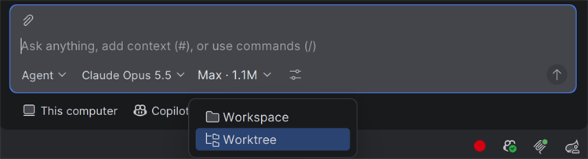

# Lesson 1: Fundamentals

**Two features at once** · Part 1 of 5 · [All lessons](../README.md)

Copilot can work on more than one task at a time. In this lesson, you run two Copilot sessions side by side, each in its own copy of the code. Then Copilot helps with your own typing, by predicting your next edit.

## The problem

Trail Store needs two small features:

- **Search.** `/?q=boots` shows only the products whose name contains "boots", ignoring case. Without `q`, the page still shows all six products. You don't need a search box.
- **Low stock.** A product with 1 to 5 left says "Only 4 left" instead of "4 in stock". The other products don't change: "12 in stock", or "Out of stock".

Build both at the same time, with two Copilot sessions that don't get in each other's way. Then make one change yourself:

- **Categories.** Each product shows its category under its name, as `<p class="category">Jackets</p>`. The jackets are in Jackets, the boots in Boots, the pack in Packs, and the tent in Tents.

Don't change the tests.

## Use

### Parallel sessions and worktrees

A session is one conversation with Copilot, about one task. Click **+** at the top of Chat to start another one. Sessions run at the same time.

Two sessions in the same folder can trip over each other's changes. A git worktree solves that: it's a second folder with its own copy of the code, on its own branch, in the same repo. Pick **Worktree** in the row under the chat box, and the session gets its own worktree, starting from your last commit. When it's done, **Apply**, above the chat box, copies its changes into your project.



### Next edit suggestions

Completions finish the line you're typing. Next edit suggestions go further: after you change one line, Copilot suggests the edit that follows from it, even in another file. Press **Tab** to jump to it, and **Tab** again to accept it. You may need to type the first category in `Catalog.java` yourself, then press **Tab** to fill in the rest. Check it's on in Settings → GitHub Copilot → Completions.

## Get started

Open this repo in IntelliJ IDEA with the GitHub Copilot plugin, and run the tests:

```bash
cd 01-fundamentals
./mvnw -B -ntp verify
```

On Windows, use `.\mvnw.cmd -B -ntp verify`. `SearchTests`, `LowStockTests` and `CategoryTests` fail.

## Try it

1. **Start the search session.** At the top of Chat, click **+**. In the row under the chat box, click **Workspace**, choose **Worktree**, and send:

   > In 01-fundamentals, make SearchTests pass. Change only what search needs, and run SearchTests to check.

2. **Start the low stock session.** Don't wait for the first one to finish. Click **+** again, choose **Worktree**, and send:

   > In 01-fundamentals, make LowStockTests pass. Change only what low stock needs, and run LowStockTests to check.

   If Copilot asks about uncommitted changes, choose **Skip Changes**. To switch between the two sessions, click **Show Sessions Side Bar** at the top of Chat.

3. **Apply both.** When a session finishes, click the list of changed files above the chat box, such as **1 File Changed**. Click a file to check its diff, then click **Apply**. Do the same in the other session. Now only `CategoryTests` fails.

4. **Add the categories yourself.** In `Product.java`, add `String category` after `name`. Copilot suggests the matching changes in `Catalog.java` and `index.html`: press **Tab** to jump to each one, and **Tab** again to accept it. If no suggestion appears, type the change yourself.

5. **Check.** Run the tests again: they all pass. To see the page, start the store with `./mvnw spring-boot:run` (on Windows, `.\mvnw.cmd spring-boot:run`), and open <http://localhost:8080/?q=boots>.

<details>
<summary>Hints</summary>

The Java files are in `src/main/java/com/contoso/store`. The page is `src/main/resources/templates/index.html`.

| Task | File | Hint |
|---|---|---|
| Search | `StoreController.java` | Add an optional `q` request parameter that defaults to `""`. Keep only the products whose name contains `q`, comparing both in lower case. |
| Low stock | `index.html` | Split the "in stock" line in two: one for more than 5 left, and one for 1 to 5 left. |
| Categories | `Catalog.java` | Once `Product` has a category, `Catalog.java` doesn't compile until each of the six products has one, between its name and its price. |
| Categories | `index.html` | Under the `<h2>`, add `<p class="category" th:text="${product.category()}">Jackets</p>`. |

To run one test class, click the green run icon next to it.

</details>

## Done when

- [ ] All the tests pass.
- [ ] Search and low stock each came from their own worktree session.
- [ ] You typed the categories yourself, with next edit suggestions when Copilot offers them.

Stuck? Read the [solution](SOLUTION.md).
