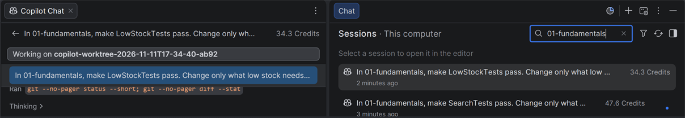
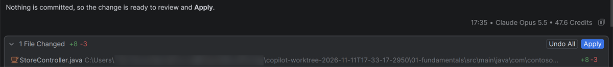
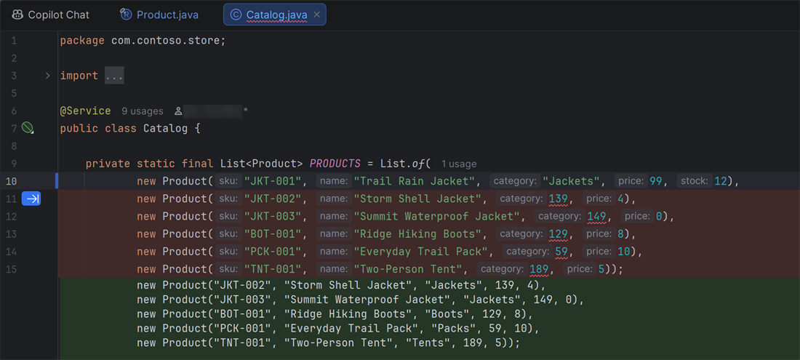

# Lesson 1: Fundamentals

**Two features at once** · Part 1 of 5 · [All lessons](../README.md)

Most of the time, you give Copilot one task, and wait while it works. But Copilot can work on more than one task at a time, and it can help with the code you type yourself, not just the code it writes.

In this lesson, you hand two small features to two Copilot sessions that run side by side, each in its own copy of the code, so they can't get in each other's way. You review each session's work before it reaches your project. Then you make a change yourself, and Copilot predicts the edits that follow from it.

## The problem

Trail Store is a small Spring Boot app, with one page that lists six products: three jackets, a pair of boots, a pack and a tent. It needs two small features:

- **Search.** `/?q=boots` shows only the products whose name contains "boots", ignoring case. Without `q`, the page still shows all six products. You don't need a search box.
- **Low stock.** A product with 1 to 5 left says "Only 4 left" instead of "4 in stock". The other products don't change: "12 in stock", or "Out of stock".

The two features don't depend on each other, so there's no need to build one after the other. Build both at the same time, with two Copilot sessions that don't get in each other's way. Then make one change yourself:

- **Categories.** Each product shows its category under its name, as `<p class="category">Jackets</p>`. The jackets are in Jackets, the boots in Boots, the pack in Packs, and the tent in Tents.

Don't change the tests: they say what each feature must do, and they tell you when it's done.

## Core concepts

### Parallel sessions

A session is one conversation with Copilot, about one task: your prompts, and everything Copilot does to answer them, such as reading files, editing code and running tests. Click **+** at the top of Chat to start another one. Sessions run at the same time, so you can start a second task while the first is still working.

### Worktrees

Two sessions in the same folder share the same files. One session's unfinished change can break the other's build, and both can change the same file at once.

A git worktree solves that. It's a second folder with its own copy of the code, on its own branch, in the same repo. Pick **Worktree** in the row under the chat box, and the session gets its own worktree, starting from your last commit. Its changes stay in the worktree, so you can review them first. When you're happy with them, **Apply**, above the chat box, copies them into your project.


### Next edit suggestions

Some changes come in a chain: add a field to a record, and every place that creates one needs a value for it. Completions finish the line you're typing. Next edit suggestions go further: after you make an edit, Copilot suggests the edit that follows from it, even elsewhere in the file. If the suggestion is where you're typing, **Tab** accepts it. If it's somewhere else, the first **Tab** jumps to it, and the second accepts it. Check it's on in Settings → GitHub Copilot → Completions.

## Get started

Open this repo in IntelliJ IDEA with the GitHub Copilot plugin, and run the tests:

```bash
cd 01-fundamentals
./mvnw -B -ntp verify
```

On Windows, use `.\mvnw.cmd -B -ntp verify`. `SearchTests`, `LowStockTests` and `CategoryTests` fail: one test for each feature. When all three pass, the features work.

## Try it

You work in two stages. First, two Copilot sessions build search and low stock at the same time, each in its own worktree, and you apply their changes when both are done. Then you add the categories yourself, with next edit suggestions.

Write your own prompts: steps 1 and 2 say what to ask for. Name the lesson's folder, `01-fundamentals`, in each one, so Copilot knows which lesson you mean. If you're stuck, open **A prompt that works**, under the step.

1. **Start the search session.** At the top of Chat, click **+**. In the row under the chat box, click **Workspace**, and choose **Worktree**. Then ask Copilot to make `SearchTests` pass. Tell it to change only what search needs, so the two sessions don't change the same files, and to run `SearchTests` to check.

   <details>
   <summary>A prompt that works</summary>

   > In 01-fundamentals, make SearchTests pass. Change only what search needs, and run SearchTests to check.

   </details>

   If an **Uncommitted Changes** card appears, click the arrow next to **Copy Changes**, and choose **Skip Changes**: the worktree starts from your last commit.

2. **Start the low stock session.** Don't wait for the first one to finish: the two sessions work at the same time. Click **+** again, and choose **Worktree**. Then ask Copilot to make `LowStockTests` pass, in the same way: change only what low stock needs, and run `LowStockTests` to check.

   <details>
   <summary>A prompt that works</summary>

   > In 01-fundamentals, make LowStockTests pass. Change only what low stock needs, and run LowStockTests to check.

   </details>

   If the **Uncommitted Changes** card appears, skip the changes again.

   To switch between the two sessions, click **Show Sessions Side Bar** at the top of Chat: the chat opens in an editor tab, with the **Sessions** list beside it. Each session asks before it runs a command, such as `git status`, even when it's not the one on screen. If a session seems stuck, switch to it: it may be waiting for you to click **Allow Once**.

   

3. **Apply both.** A session's changes stay in its worktree until you apply them, so this is where you review them. When a session finishes, the files it changed are listed above the chat box. Click the arrow before the list's header, such as **1 File Changed**, to open it. Click a file to check its diff, then click **Apply**. There's no confirmation: the list just closes. Do the same in the other session. Now only `CategoryTests` fails.

   

4. **Add the categories yourself.** This change is a chain of small edits, the kind that next edit suggestions are for. In `Product.java`, add `String category` after `name`. Then:

   - In `Catalog.java`, type the first product's category, `"Jackets",`, after its name. Copilot suggests the other five categories: press **Tab** to accept them.

     

     *The arrow in the gutter means Tab accepts.*

   - In `index.html`, click at the end of the `<h2>` line, and press **Enter**. Copilot suggests the category line: press **Tab** to accept it.

   If no suggestion appears, or Copilot fills in only some of the categories, type the rest yourself.

5. **Check.** Run the tests again: they all pass. To see the page, start the store with `./mvnw spring-boot:run` (on Windows, `.\mvnw.cmd spring-boot:run`), and open <http://localhost:8080/?q=boots>.

<details>
<summary>Hints</summary>

The Java files are in `src/main/java/com/contoso/store`. The page is `src/main/resources/templates/index.html`.

| Task | File | Hint |
|---|---|---|
| Search | `StoreController.java` | Add an optional `q` request parameter that defaults to `""`. Keep only the products whose name contains `q`, comparing both in lower case. |
| Low stock | `index.html` | Split the "in stock" line in two: one for more than 5 left, and one for 1 to 5 left. |
| Categories | `Catalog.java` | Once `Product` has a category, `Catalog.java` doesn't compile until each of the six products has one, between its name and its price. |
| Categories | `index.html` | Under the `<h2>`, add `<p class="category" th:text="${product.category()}">Jackets</p>`. |

To run one test class, click the green run icon next to it.

</details>

## Done when

- [ ] All the tests pass.
- [ ] Search and low stock each came from their own worktree session.
- [ ] You typed the categories yourself, with next edit suggestions when Copilot offers them.
- [ ] You can say why you added the categories after you applied both sessions, not before.

Stuck? Read the [solution](SOLUTION.md).

---

[← Back to the start](../README.md) · [Next lesson: Tooling →](../02-tooling/README.md)
