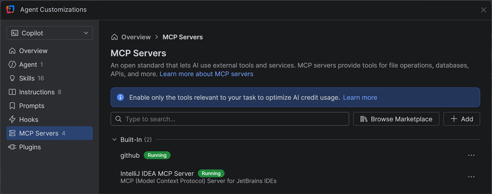
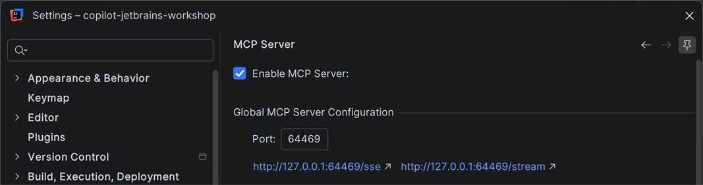
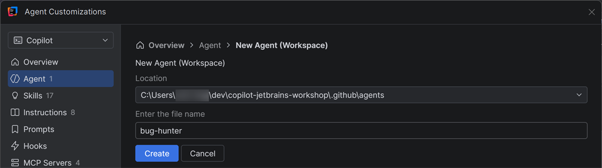
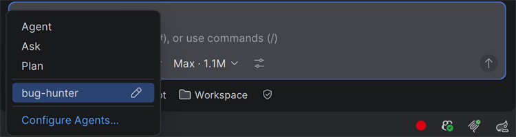

# Lesson 2: Tooling

**Free jackets** · Part 2 of 5 · [All lessons](../README.md)

Out of the box, Copilot knows a lot about code in general, but not how your team works. And it reaches your project through its own tools: it reads and edits files, and runs commands in the terminal. It works better when it knows your project, and when it can use the same tools you do.

In this lesson, you shape Copilot for this workspace with a plugin, a custom agent and a skill. Then you connect it to IntelliJ's own tools, so it can find a bug the way you would: with the test runner and the debugger, not by guessing.

## The problem

It's sale week: every jacket is 20% off. But the store sells the jackets for $0.

Find the bug and fix it, with Copilot doing the work through IntelliJ's own test runner, debugger and refactorings. The jackets should cost $79, $111 and $119: 20% off $99, $139 and $149, rounded down to whole dollars. Don't change the tests.

To get there, set up Copilot for this workspace first, and once the bug is fixed, rename one method:

- Install the **java-development** plugin.
- Create a **bug-hunter** custom agent and a **run-the-store** skill, for the workspace.
- Rename `currentPrices()` in `Catalog.java` to `products()`, with IntelliJ's rename refactoring: it returns products, not prices. If you do the rename yourself with **Shift+F6**, untick **Search in comments and strings** and **Search for text occurrences**, so the rename changes only code.

## Core concepts

### Customization panel

**Customizations**, at the top of Chat, is where you shape what Copilot knows and can do. This lesson uses three kinds of customization:

- A **plugin** is a ready-made bundle, such as prompts, instructions and agents, from a marketplace. It's the quickest way to use what others have already written.
- A **custom agent** is Copilot with your own instructions for one kind of job, such as fixing bugs. You pick it in the **Agent** selector in the chat box, and it follows those instructions in every prompt you send it.
- A **skill** teaches Copilot one task, such as how to run the store. You don't pick a skill: Copilot reads each skill's description, and loads the skill when a task needs it.

The agents and skills you create for the workspace are files in `.github/`, so everyone who clones the repo gets them. See [Using custom agents in your IDE](https://docs.github.com/en/copilot/how-tos/copilot-in-your-ide/use-copilot-agents/use-custom-agents?tool=jetbrains) and [Agent skills](https://docs.github.com/en/copilot/concepts/agents/about-agent-skills).

### Built-in MCP server

MCP, the Model Context Protocol, is an open standard that lets AI use tools from other programs. A program that offers tools this way is an MCP server. IntelliJ has its own, so Copilot can use IntelliJ's test runner, debugger and rename refactoring, not just the terminal.

That matters for this challenge. The debugger shows the values the code really computes, so Copilot can find the cause instead of guessing. IntelliJ's rename knows which code calls a method, so it changes the method and its callers, and nothing else.

Turn it on in Settings → MCP Server (in some versions, under AI), or search Settings for MCP Server. It runs inside IntelliJ, so its tools run outside the sandbox you'll meet in lesson 3: turn it off when you finish this lesson. See [MCP Server](https://www.jetbrains.com/help/idea/mcp-server.html) in the IntelliJ IDEA docs.



### Browser use, optional

The tests check the page's HTML, but you might also want to see a change the way a shopper does. With browser use, Copilot opens pages in your own browser and reads them, so it can check a change in the running app. It's a preview, and still rolling out. It needs Node.js 22 or later, and Chrome or Edge with the GitHub Copilot browser extension. Turn on **Enable Browser Use**, under Settings → GitHub Copilot → Chat (search Settings for Browser Use): if it isn't there, you don't have browser use yet. Copilot then uses your browser when a task needs it, or when you use the `/browser-use` command. See [Using GitHub Copilot in your IDE to interact with your browser](https://docs.github.com/en/copilot/how-tos/copilot-in-your-ide/use-copilot-agents/browser-use).

## Get started

Copilot uses IntelliJ's test runner and debugger in this lesson, so set up the project in IntelliJ first:

- If the **Maven** tool window is empty, right-click the `pom.xml` at the top of the repo, and choose **Add as Maven Project**.
- In File → Project Structure → Project, set **SDK** to JDK 25.

Then run the tests:

```bash
cd 02-tooling
./mvnw -B -ntp verify
```

On Windows, use `.\mvnw.cmd -B -ntp verify`. `SaleTests` fails: the jackets should cost $79, $111 and $119.

## Try it

You work in three stages. First, set Copilot up: turn on IntelliJ's MCP server, and add the plugin, the agent and the skill. Then hand the bug to your bug-hunter agent, which uses IntelliJ's test runner and debugger to find the cause before it changes any code. Last, rename the method with IntelliJ's rename refactoring, and turn the MCP server off again.

Write your own prompts: steps 3 and 4 say what to ask for. Name the lesson's folder, `02-tooling`, in each one, so Copilot knows which lesson you mean. If you're stuck, open **A prompt that works**, under the step.

1. **Turn on IntelliJ's MCP server.** In Settings → MCP Server (in some versions, under AI), select **Enable MCP Server**, and click **OK**.

   

   Copilot can now use IntelliJ's tools. In **Customizations**, at the top of Chat, **MCP Servers** lists **IntelliJ IDEA MCP Server** as **Running**. If it shows **Error**, restart IntelliJ.

2. **Fill the Customization panel.** In **Customizations**:

   - Under **Plugins**, click **Browse Marketplace**, search for `java-development`, and click **Install**. If the search fails, wait a moment and try again.

   - Click **Agent**, click the arrow next to **Generate Agent**, and choose **New Agent (Workspace)**. Enter `bug-hunter`, and click **Create**.

     

     The new file opens in an editor: replace all its text with the agent in **Hints**, and click **Save**, at the top right of the editor.

   - Click **Skills**, click the arrow next to **Generate Skill**, and choose **New Skill (Workspace)**. Enter `run-the-store`, and click **Create**. Replace all its text with the skill in **Hints**, and click **Save**.

   If the **Agent** selector, in the chat box, doesn't list **bug-hunter**, restart IntelliJ.

3. **Find the bug.** Start a new session. If the row under the chat box says **Worktree**, change it to **Workspace**: IntelliJ's test runner and debugger work on the project you have open, not on a worktree. Pick **bug-hunter** in the **Agent** selector.

   

   Then hand it the bug: say what's wrong and which test fails, and ask it to find the cause and fix it.

   <details>
   <summary>A prompt that works</summary>

   > In 02-tooling, jackets should be 20% off, but the store sells them for $0. SaleTests fails. Find out why and fix it.

   </details>

   Copilot runs `SaleTests`, debugs it in IntelliJ's debugger, and reads the values at a breakpoint. Check each command it asks to run, and confirm it. When it's done, click **Keep All**, above the chat box, to keep the fix.

   If Copilot explains the bug but doesn't change the code, send: `Fix it.`

4. **Rename with IntelliJ.** With the tests passing, give `currentPrices()` a name that says what it returns. Ask Copilot to rename it to `products()`. Your prompt must make it use IntelliJ's rename refactoring, and change only code, not comments or text.

   <details>
   <summary>A prompt that works</summary>

   > In 02-tooling, rename the currentPrices() method in Catalog.java to products(), with IntelliJ's rename refactoring. Rename code only, without searching comments and text.

   </details>

   The rename changes only `Catalog.java` and `StoreController.java`. If Copilot doesn't use IntelliJ's rename, do the rename yourself: in `Catalog.java`, click `currentPrices`, press **Shift+F6**, type `products`, untick **Search in comments and strings** and **Search for text occurrences**, and press **Enter**.

5. **Check the page (optional).** In `02-tooling`, start the store with `./mvnw spring-boot:run` (on Windows, `.\mvnw.cmd spring-boot:run`), and open <http://localhost:8080>. The jackets cost $79, $111 and $119. Stop the store with **Ctrl+C**.

6. **Turn off IntelliJ's MCP server.** In Settings → MCP Server, untick **Enable MCP Server**. It runs inside IntelliJ, so its tools run outside the sandbox in lesson 3.

<details>
<summary>Hints</summary>

The agent, `.github/agents/bug-hunter.agent.md`:

```markdown
---
description: Fixes bugs with IntelliJ's test runner and debugger.
---
Work only in 02-tooling, and keep the tests unchanged.
Fix bugs with evidence:
1. Run the failing test with IntelliJ's test runner.
2. Debug the test in IntelliJ, and read the variables at a breakpoint.
3. Explain the cause in one sentence, make the smallest fix, and run the test again.
```

The skill, `.github/skills/run-the-store/SKILL.md`:

```markdown
---
name: run-the-store
description: Runs the tests and starts the store for one lesson of this workshop.
---
Each lesson is its own app, in its own folder, like 02-tooling.
Run the tests with ./mvnw -B -ntp verify (on Windows, .\mvnw.cmd -B -ntp verify).
Start the store with ./mvnw spring-boot:run, and open http://localhost:8080.
```

The bug is in `withSalePrice()`, in `Catalog.java`. What is `(100 - JACKET_SALE_PERCENT) / 100`, when Java divides two whole numbers?

If Copilot doesn't debug, set a breakpoint yourself: click in the gutter next to the `salePrice` line. Then, in `SaleTests.java`, click the green run icon next to the class, and choose **Debug**.

</details>

## Done when

- [ ] All the tests pass.
- [ ] Copilot found the bug in IntelliJ's debugger.
- [ ] `currentPrices()` in `Catalog.java` is renamed to `products()`, by IntelliJ's rename refactoring.
- [ ] Customizations lists your plugin, agent and skill.
- [ ] IntelliJ's MCP server is off.
- [ ] You can say, in one sentence, why the jackets cost $0.

Stuck? Read the [solution](SOLUTION.md).

---

[← Back to the start](../README.md) · [Next lesson: Secure execution and governance →](../03-secure-execution/README.md)
