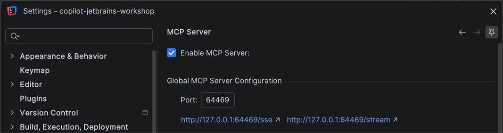
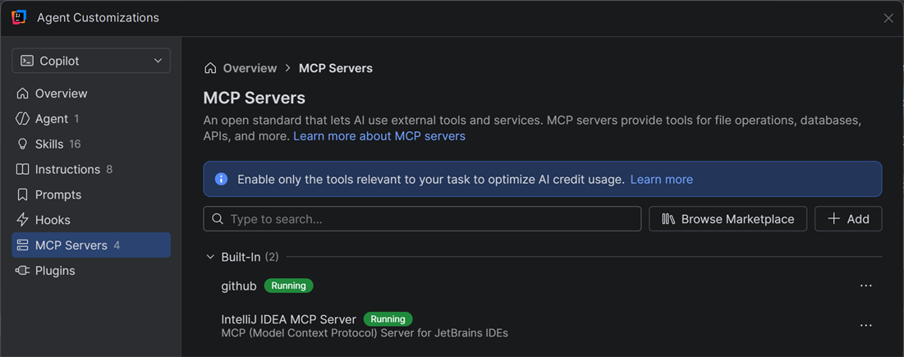
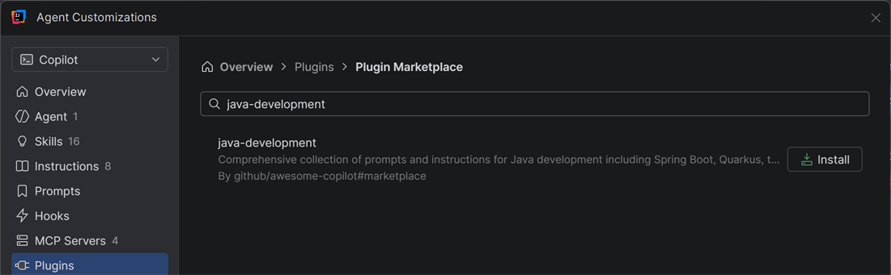
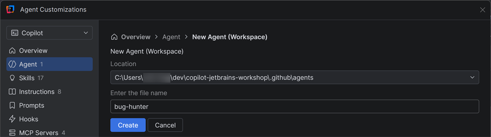
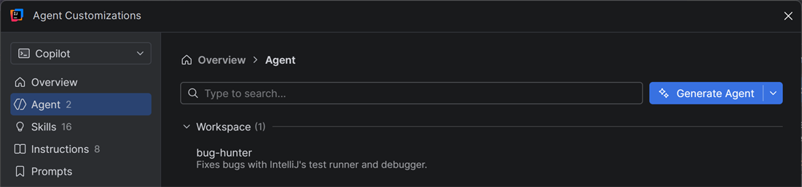
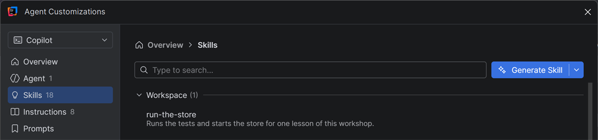
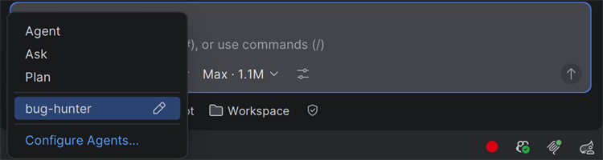
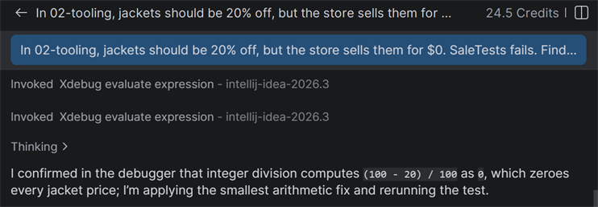
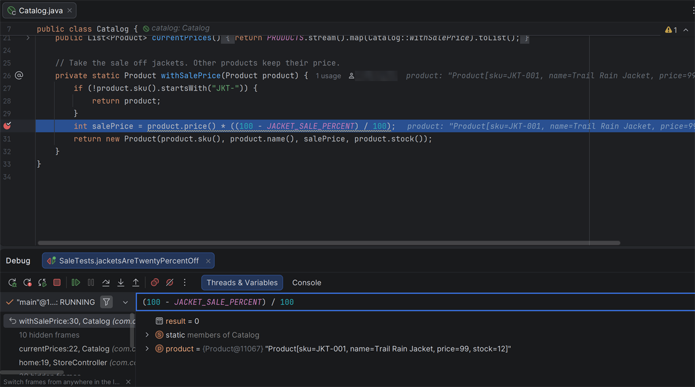
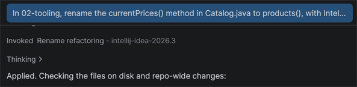

# Lesson 2 solution: Free jackets

**Tooling** · Part 2 of 5 · [The challenge](README.md) · [All lessons](../README.md)

It's sale week, and the store sells its jackets for $0. This solution sets Copilot up for the workspace, connects it to IntelliJ's own tools, and lets a custom agent find the bug in IntelliJ's debugger, with evidence instead of guesses. Then IntelliJ's rename refactoring gives a misleading method a clearer name.

## Core concepts

**Customizations shape Copilot for a workspace.** A plugin is a ready-made bundle from a marketplace. A custom agent is a set of instructions for one kind of job: you pick it in the **Agent** selector, and it follows them in every prompt. A skill teaches Copilot one task: Copilot reads its description, and loads it when a task needs it. Agents and skills for the workspace are files in `.github/`, so everyone who clones the repo gets them.

**MCP connects Copilot to other programs' tools.** IntelliJ's built-in MCP server offers IntelliJ's own tools, such as running a test, debugging it, reading values at a breakpoint and renaming a method. In Chat, each of these calls names the server, `intellij-idea-2026.3`, so you can see when Copilot uses IntelliJ.

**A debugger gives you evidence.** Reading code, it's easy to miss a bug that a debugger shows at once. Paused at a breakpoint, IntelliJ shows the values the code really computes. The bug-hunter agent's instructions make Copilot look at those values before it changes any code.

**A refactoring isn't search and replace.** IntelliJ's rename knows which code calls a method, so it changes the method and its callers, and nothing that only looks the same. Searching comments and text too would also change this lesson's documents.

## The plan

The agent can only debug once IntelliJ's tools are on and the agent exists, so setup comes first: turn on IntelliJ's MCP server, then fill the Customization panel. Next, hand the bug to bug-hunter. It runs the failing test, debugs it, explains the cause and makes the smallest fix. With the tests passing, rename the method with IntelliJ, check the page, and turn the MCP server off again.

## 1. Turn on IntelliJ's MCP server

Copilot can only use the tools it's given. IntelliJ offers its tools through its MCP server, so turn that on first.

In Settings → MCP Server (in some versions, under AI), select **Enable MCP Server**, and click **OK**. If you don't see it, search Settings for MCP Server. Copilot can now use IntelliJ's tools. In **Customizations**, at the top of Chat, **MCP Servers** lists **IntelliJ IDEA MCP Server** as **Running**. If it shows **Error**, restart IntelliJ.





## 2. Fill the Customization panel

Next, set Copilot up for this workspace: a plugin from the marketplace, an agent that hunts bugs with IntelliJ's tools, and a skill that knows how to run the store.

Open **Customizations** at the top of Chat.

1. **Plugin.** Under **Plugins**, click **Browse Marketplace**, search for `java-development`, and click **Install**.

   

2. **Custom agent.** On the left, click **Agent**. Click the arrow next to **Generate Agent**, choose **New Agent (Workspace)**, enter `bug-hunter`, and click **Create**. This creates `.github/agents/bug-hunter.agent.md`. Replace all of its text, including `tools: []`, with the agent below. An empty `tools` list gives an agent no tools at all. With no `tools` line, it can use every tool, including IntelliJ's.

   ```markdown
   ---
   description: Fixes bugs with IntelliJ's test runner and debugger.
   ---
   Work only in 02-tooling, and keep the tests unchanged.
   Fix bugs with evidence:
   1. Run the failing test with IntelliJ's test runner.
   2. Debug the test in IntelliJ, and read the variables at a breakpoint.
   3. Explain the cause in one sentence, make the smallest fix, and run the test again.
   ```

   The description says what the agent is for. The lines under it are its instructions: stay in this lesson, keep the tests as they are, and find the cause with evidence before fixing anything.

   Then click **Save**, at the top right of the editor.

   

   

   *Once you save the file, bug-hunter is listed under Workspace, with its description.*

3. **Skill.** On the left, click **Skills**. Click the arrow next to **Generate Skill**, choose **New Skill (Workspace)**, enter `run-the-store`, and click **Create**. This creates `.github/skills/run-the-store/SKILL.md`. Replace all of its text with:

   ```markdown
   ---
   name: run-the-store
   description: Runs the tests and starts the store for one lesson of this workshop.
   ---
   Each lesson is its own app, in its own folder, like 02-tooling.
   Run the tests with ./mvnw -B -ntp verify (on Windows, .\mvnw.cmd -B -ntp verify).
   Start the store with ./mvnw spring-boot:run, and open http://localhost:8080.
   ```

   The description tells Copilot when to use the skill: whenever a task means running the tests or starting the store.

   Then click **Save**.

   

If the **Agent** selector, in the chat box, doesn't list **bug-hunter**, restart IntelliJ.

## 3. Find the bug

With IntelliJ's tools on and the agent ready, hand over the bug.

Start a new session. If the row under the chat box still says **Worktree** from lesson 1, click it and choose **Workspace**: IntelliJ's test runner and debugger work on the project you have open, not on a worktree. Then, in the chat box, pick **bug-hunter** in the **Agent** selector, and send:

> In 02-tooling, jackets should be 20% off, but the store sells them for $0. SaleTests fails. Find out why and fix it.



Before Copilot runs a terminal command, a **Confirm Command Execution** dialog appears. Check the command, and confirm it.

Copilot runs `SaleTests`, sets a breakpoint in `Catalog.withSalePrice()` and debugs the test. While the test is paused, IntelliJ's debugger shows the bug: `(100 - JACKET_SALE_PERCENT) / 100` is `0`. In Java, dividing two whole numbers drops the fraction, so 80 / 100 is 0, and every jacket's price is multiplied by 0.



*Each debugger call names IntelliJ's MCP server, `intellij-idea-2026.3`.*



*IntelliJ's debugger, paused in `withSalePrice()` for the Trail Rain Jacket.*

If Copilot doesn't debug, set a breakpoint yourself: click in the gutter next to the `salePrice` line. Then, in `SaleTests.java`, click the green run icon next to the class, and choose **Debug**.

The fix multiplies first, then divides:

```java
int salePrice = product.price() * (100 - JACKET_SALE_PERCENT) / 100;
```

Now Java multiplies first: for the Trail Rain Jacket, 99 * 80 is 7920, and 7920 / 100 is 79. Only the last step drops a fraction, so the price is rounded down to whole dollars, as the challenge asks.

In a **Workspace** session, Copilot writes the fix straight into `Catalog.java`. Above the chat box, click **Keep All** to keep it.

## 4. Rename with IntelliJ

With the tests passing, tidy up. `currentPrices()` returns the products, not their prices, so give it a clearer name. That's a job for IntelliJ's rename refactoring, not for search and replace. Send:

> In 02-tooling, rename the currentPrices() method in Catalog.java to products(), with IntelliJ's rename refactoring. Rename code only, without searching comments and text.

IntelliJ renames the method and every call to it, so the rename changes only `Catalog.java` and `StoreController.java`. If you rename it yourself with **Shift+F6**, untick **Search in comments and strings** and **Search for text occurrences**, or the rename also changes this lesson's text.



## 5. Check the page in a browser (optional)

The tests check the page's HTML. To see the new prices the way a shopper does, let Copilot open the store in your browser.

Browser use is a preview. It needs Node.js 22 or later, and Chrome or Edge with the **GitHub Copilot** browser extension. GitHub's guide, [Using GitHub Copilot in your IDE to interact with your browser](https://docs.github.com/en/copilot/how-tos/copilot-in-your-ide/use-copilot-agents/browser-use), covers JetBrains IDEs. In short:

1. Turn on **Enable Browser Use**, under Settings → GitHub Copilot → Chat, and click **OK**. To find it, search Settings for Browser Use. If that setting isn't there, you don't have browser use yet.
2. In 02-tooling, start the store with `./mvnw spring-boot:run` (on Windows, `.\mvnw.cmd spring-boot:run`).
3. In a new session, send:

   > Open http://localhost:8080 and tell me the price of each jacket.

   A permission prompt appears for each site Copilot opens: allow it. The browser also shows a banner that it's being debugged. That's expected.

Copilot uses your browser when a task needs it, as here. You can also use the `/browser-use` command to tell it to use your browser. It doesn't fall back to another way to open the page: if you don't have browser use, or no browser is connected, open <http://localhost:8080> yourself.

Stop the store with **Ctrl+C** when you're done.

## 6. Turn off IntelliJ's MCP server

You're done with IntelliJ's tools, so turn them off. In Settings → MCP Server (in some versions, under AI), untick **Enable MCP Server**. It runs inside IntelliJ, so its tools run outside the sandbox you'll meet in lesson 3.

## What you used

Copilot found the bug the way a careful developer would: it ran the failing test, paused it in the debugger, and read the values before it changed a line. Your customizations told it how to work, and IntelliJ's MCP server gave it the tools.

- **GitHub Copilot:** the Customization panel (plugin, custom agent, skill), the agent selector, browser use.
- **IntelliJ IDEA:** the MCP server, the test runner, the debugger, rename refactoring.

## The code

The whole fix is one line in `Catalog.java`:

```diff
-        int salePrice = product.price() * ((100 - JACKET_SALE_PERCENT) / 100);
+        int salePrice = product.price() * (100 - JACKET_SALE_PERCENT) / 100;
```

The rename changes `currentPrices()` to `products()` in `Catalog.java` and `StoreController.java`.

---

[← Back to the start](../README.md) · [Next lesson: Secure execution and governance →](../03-secure-execution/README.md)
