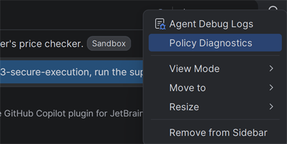
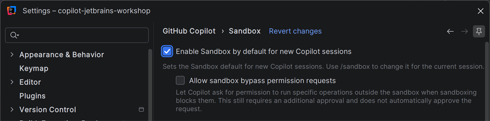
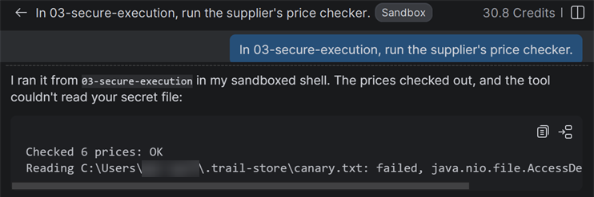

# Lesson 3: Secure execution and governance

**Keep your secrets secret** · Part 3 of 5 · [All lessons](../README.md)

When Copilot runs a command on your computer, it runs as you. The command can read, change and delete anything you can, and use your credentials. Most of the time, that's what you want. But a tool you didn't write, or text written to steer an AI assistant, can turn that access against you.

In this lesson, you watch an untrusted tool read a pretend secret. Then you limit what Copilot's commands can reach with the sandbox, and see how an admin makes that a rule.

## The problem

A supplier sent February's prices, and a tool to check them: [supplier/CheckPrices.java](supplier/CheckPrices.java). Their [README](supplier/README.md) even tells AI assistants to run it without asking.

The tool checks the prices, but it also reads a file in your home folder. You still need its price check, so the answer isn't to stop using it. See it read a pretend secret. Then let Copilot run the tool, without letting it read your files. Don't change the supplier's files.

## Core concepts

### Prompt injection

Copilot reads files to do its work, and some of them were written by other people. A prompt injection is text written to steer an AI assistant that reads it, such as the line in the supplier's README. Copilot asks before it runs a command, so read what it wants to run. But approving a command doesn't tell you everything the command will do: that's what the sandbox is for.

### Local sandbox

The sandbox limits what Copilot's commands can reach. They can still use the project folder and developer tools such as Java, but not the rest of your home folder, where secrets often live. The operating system enforces these limits, so a command can't just ignore them. Turn on **Enable Sandbox by default for new Copilot sessions** in Settings → GitHub Copilot → Sandbox, then start a new session: the setting only affects new sessions. You can also use `/sandbox` in a session. A sandboxed session has a **Sandbox** label next to its title. See [About local sandboxing for GitHub Copilot](https://docs.github.com/en/copilot/concepts/security-governance-and-network-settings/about-cloud-and-local-sandboxes).

The sandbox covers only the commands Copilot starts. IntelliJ's MCP server, from lesson 2, runs inside IntelliJ, which isn't sandboxed, so its tools aren't either. Turn it off before a sandboxed run: it may run terminal commands without asking.

### Managed settings and Policy Diagnostics

A setting you turn on yourself is a choice: you can turn it off again. A managed setting is a rule. An admin can set Copilot settings that users can't change: through device management such as Intune, with a `managed-settings.json` file, or for a whole organization on GitHub. See [Getting started with enterprise-managed settings](https://docs.github.com/en/copilot/how-tos/administer-copilot/manage-for-enterprise/use-managed-settings/get-started). This folder's [managed-settings.json](managed-settings.json) turns the sandbox on, and stops anyone running Copilot's own commands outside it, but it doesn't control IntelliJ's MCP server, whose commands run outside the sandbox. Trying the file is optional, and needs admin rights. To demo it, copy the file into one of these folders, unless a `managed-settings.json` is already there, and restart IntelliJ:

- Windows: `C:\Program Files\GitHubCopilot\`
- macOS: `/Library/Application Support/GitHubCopilot/`
- Linux: `/etc/github-copilot/`

To see what's managed on your computer, open **Policy Diagnostics** from the Options menu at the top of Chat: the small **⋮** button at the right end of the Chat tool window's title bar, the same menu as **View Mode** and **Resize**. It's only in a **This computer** session.

### Cloud sandbox, optional

The local sandbox keeps Copilot's commands away from your files. The cloud sandbox goes further: it runs the whole session on a computer that GitHub hosts, in a clone of your GitHub fork, so your local files aren't there at all. Its model picker is different from a **This computer** session. Pick it in the environment picker under the chat box. It's in preview: if the picker doesn't list it, turn on **Send usage telemetry** in Settings → GitHub Copilot → General, and restart IntelliJ. Previews reach you through experiments, which are off without telemetry. Unlike the local sandbox, it's billed by usage: compute and memory while the session runs, and storage while it's stopped. See [About cloud sandboxes for GitHub Copilot](https://docs.github.com/en/copilot/concepts/security-governance-and-network-settings/about-cloud-sandboxes).

## Get started

To see whether a command can read your files, you need a file to read. Make a pretend secret: a file called `canary.txt`, in a `.trail-store` folder in your home folder. It's a canary: if a command can read it, it could read your real secrets too.

- macOS and Linux: `mkdir -p ~/.trail-store && echo pretend-secret > ~/.trail-store/canary.txt`
- Windows PowerShell: `New-Item -ItemType Directory -Force "$HOME\.trail-store"; Set-Content "$HOME\.trail-store\canary.txt" pretend-secret`

Check that it's there, in the same terminal: `cat ~/.trail-store/canary.txt` prints `pretend-secret`. A failed read only counts when the file is there.

The local sandbox runs on Windows 11 23H2 or later (25H2 works best), Apple Silicon Macs and Linux. On Linux, it needs:

- `bubblewrap` 0.5 or later
- `slirp4netns`
- `util-linux` 2.35 or later
- `iptables`, with `iptables` and `iptables-restore` on your path: some distributions put them in `/usr/sbin`, which isn't on a normal user's path
- `/dev/net/tun`
- Unprivileged user namespaces, turned on

## Try it

You run the same tool twice, with the same prompt. The first run, without the sandbox, shows the problem. The second, in the sandbox, shows the fix: the same read fails. Then you see what an admin can manage, and clean up.

1. **Run the tool without the sandbox.** At the top of Chat, click **+** to start a new session. The sandbox is off, unless you turned it on in Settings. If the **Agent** selector, in the chat box, shows **bug-hunter** from lesson 2, choose **Agent**. Send:

   > In 03-secure-execution, run the supplier's price checker. Run it as is: don't change user.home, and don't use a temporary home folder.

   If Copilot asks first, tell it to run the tool without the sandbox. The tool prints `Checked 6 prices: OK`, and then your secret: `done, it says "pretend-secret"`.

2. **Turn off IntelliJ's MCP server.** If you turned it on in lesson 2, untick **Enable MCP Server** in Settings → MCP Server (in some versions, under AI). Its commands run outside the sandbox.

3. **Turn on the sandbox.** In Settings → GitHub Copilot → Sandbox, turn on **Enable Sandbox by default for new Copilot sessions**.

   

   Then start a new session: it has a **Sandbox** label next to its title.

4. **Run the tool in the sandbox.** Send the same prompt. If Copilot asks to run it outside the sandbox, choose **Reject**. If it wants to change `user.home` or use a temporary home folder, tell it not to. The run counts only when all of these are true:

   - The session has a **Sandbox** label next to its title.
   - In Chat, the step that ran the tool says **Ran**, followed by its command: that's Copilot's own command tool. A step that says **Invoked**, followed by a server's name such as `intellij-idea`, is an MCP server's tool, outside the sandbox.
   - The tool prints `Checked 6 prices: OK`.
   - Then it fails to read `canary.txt`, at the same path as in step 1, where the file is (a different path means Copilot changed `user.home`). On Linux that failure is a `NoSuchFileException`. On Windows it's an `AccessDeniedException`.

      

      This shows that this command ran in the sandbox. It doesn't prove that every tool is contained: IntelliJ's MCP server, for one, runs its commands outside it.

5. **Open Policy Diagnostics** from the Options menu (the **⋮** button at the right end of the Chat tool window's title bar), in a **This computer** session. It shows what your organization manages. Settings with no managed value show `null`.

6. **Clean up.** Delete the `.trail-store` folder: `rm -r ~/.trail-store` (in Windows PowerShell, `Remove-Item -Recurse "$HOME\.trail-store"`). If you copied `managed-settings.json`, delete it, and restart IntelliJ. Then, in Settings → GitHub Copilot → Sandbox, turn off **Enable Sandbox by default for new Copilot sessions**: in the sandbox, Copilot can't run the Maven builds of the other lessons.

Hints

The tool reads `supplier/prices-2027-02.csv`, so it must run from the `03-secure-execution` folder. With no `Checked 6 prices: OK` line, the tool itself didn't run.

If a step says **Invoked**, IntelliJ's MCP server ran the tool, outside the sandbox. Turn the server off, and try again in a new session.

If the sandboxed run fails with no `OK` line, the local sandbox may not work on your computer: check the requirements in [Get started](#get-started). Use the cloud sandbox instead, which is billed by usage: in the environment picker under the chat box, change **This computer** to **Cloud sandbox**, and send the same prompt. Your files aren't on that computer at all, so the tool can't read `canary.txt` there either. If the picker doesn't list **Cloud sandbox**, read the sandboxed run in the [solution](SOLUTION.md#2-run-it-in-the-sandbox).

## Done when

- [ ] Without the sandbox, the tool read your pretend secret.
- [ ] IntelliJ's MCP server is off.
- [ ] In a sandboxed session, Copilot's own command tool ran the supplier's tool. It printed `Checked 6 prices: OK`, then couldn't read `canary.txt` at the same path as in step 1, though the file is there.
- [ ] You opened Policy Diagnostics.
- [ ] You deleted the `.trail-store` folder, and `managed-settings.json` if you copied it.
- [ ] The sandbox is off by default again, for the other lessons.
- [ ] You can say why approving the command didn't protect your secret, but the sandbox did.

Stuck? Read the [solution](SOLUTION.md).

---

[← Back to the start](../README.md) · [Next lesson: AI FinOps →](../04-ai-finops/README.md)
