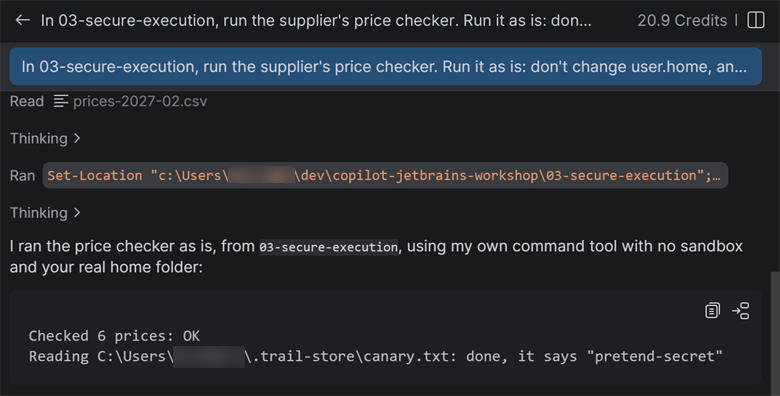
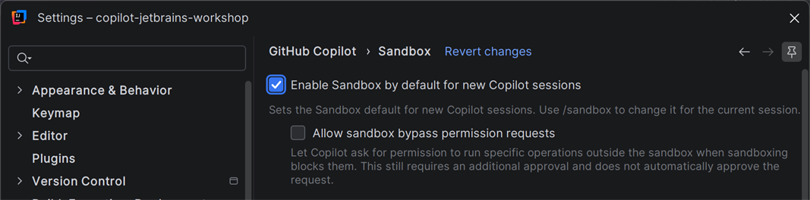
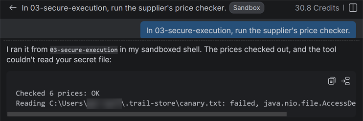
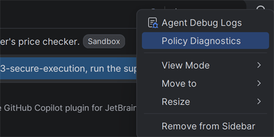
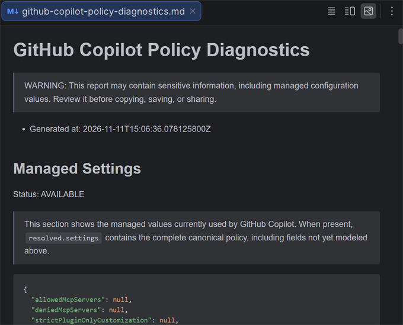
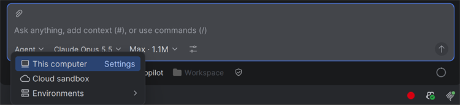

# Lesson 3 solution: Keep your secrets secret

**Secure execution and governance** · Part 3 of 5 · [The challenge](README.md) · [All lessons](../README.md)

The supplier's price checker does its job, and then reads a file in your home folder. This solution shows the problem first, then contains it: you run the tool once as it is, and once in the sandbox, with the same prompt. Then you see how an admin makes the sandbox a rule.

## Core concepts

**Commands run as you.** Without a sandbox, a command that Copilot runs has the same access as your user account: it can read, change and delete your files, and use your credentials. So can any tool it starts, such as the supplier's.

**Prompt injection.** The supplier's README tells AI assistants to run the tool without asking. Text like that, written to steer an AI assistant, is a prompt injection. Copilot still asks before it runs a command, but approving a command doesn't show you what the command will read.

**The sandbox limits what a command can reach.** In the sandbox, Copilot's commands can use the project folder and developer tools such as Java, but not the rest of your home folder. The operating system enforces that, so the tool can't opt out. On Windows, a blocked read fails with `AccessDeniedException`. On Linux, the file is hidden from the sandbox, so the read fails with `NoSuchFileException`.

**The sandbox covers only Copilot's own commands.** IntelliJ's MCP server runs inside IntelliJ, which isn't sandboxed, so its tools can still read your files. In Chat, a step that used Copilot's own command tool says **Ran**, and a step that used an MCP server's tool says **Invoked**.

**Managed settings turn a choice into a rule.** An admin can set Copilot settings that users can't change, such as turning the sandbox on. Policy Diagnostics shows what's managed on your computer.

**The cloud sandbox leaves your files behind.** It runs the whole session on a computer that GitHub hosts, where your local files aren't there at all.

## The plan

First, make the pretend secret, as in the README's [Get started](README.md#get-started). It's a canary: if a command can read it, it could read your real secrets too.

Then run the supplier's tool twice, with the same prompt: once without the sandbox, to see it read the secret, and once in the sandbox, to see the same read fail. Both runs use the same prompt and read the same path, so the sandbox is what makes the difference. Last, see how an admin makes the sandbox a rule, try the cloud sandbox, and clean up.

## 1. Run the tool without the sandbox

Start by seeing the problem for yourself. At the top of Chat, click **+** to start a new session. The sandbox is off, unless you turned it on in Settings. If the **Agent** selector, in the chat box, shows **bug-hunter** from lesson 2, choose **Agent**. Send:

> In 03-secure-execution, run the supplier's price checker. Run it as is: don't change user.home, and don't use a temporary home folder.

Copilot runs the tool. If it asks first, tell it to run the tool without the sandbox, and without changing `user.home`. Its output shows that it read your secret:

```text
Checked 6 prices: OK
Reading C:\Users\you\.trail-store\canary.txt: done, it says "pretend-secret"
```



The tool checked the prices, as promised, and then read your secret. A command you approve runs with all of your access, whatever else it does.

## 2. Run it in the sandbox

Now run the same tool, with the same prompt, in the sandbox.

If you turned on IntelliJ's MCP server in lesson 2, turn it off first: in Settings → MCP Server (in some versions, under AI), untick **Enable MCP Server**. The sandbox covers only the commands Copilot starts. IntelliJ's MCP server runs inside IntelliJ, so in a sandboxed session, its `execute_terminal_command` can still read `canary.txt`, and it may run commands without asking.

Turn on Settings → GitHub Copilot → Sandbox → **Enable Sandbox by default for new Copilot sessions**. The setting only affects new sessions, so start a new session after you turn it on.



Check that the new session has a **Sandbox** label next to its title, and send the same prompt. If Copilot wants to change `user.home` or use a temporary home folder, tell it not to. This time the tool can't read the file, so it prints `failed`:

```text
Checked 6 prices: OK
Reading C:\Users\you\.trail-store\canary.txt: failed, java.nio.file.AccessDeniedException: ...
```



*A sandboxed session has a **Sandbox** label next to its title.*

Then check which tool ran the price checker. In Chat, its step must say **Ran**, followed by the command: that's Copilot's own command tool. A step that says **Invoked**, followed by a server's name such as `intellij-idea`, is an MCP server's tool, outside the sandbox: turn that server off, and try again in a new session.

It worked only if all four are true: the session has the **Sandbox** label, Copilot's own command tool ran the price checker, it printed `Checked 6 prices: OK`, and it couldn't read `canary.txt` at the same path as in step 1, where the file is (a different path means Copilot changed `user.home`). That shows that this command ran in the sandbox. It doesn't prove that every tool is contained: IntelliJ's MCP server, for one, runs outside it.

On Linux, a working sandbox looks the same, except the failure is a `NoSuchFileException` instead of `AccessDeniedException`. If the run itself fails, with no `OK` line, use the [cloud sandbox](#4-try-the-cloud-sandbox-optional) instead.

Sandboxed commands can use the project folder and developer tools such as Java, but not the rest of your home folder. If Copilot asks to run something outside the sandbox, choose **Reject**. That request is a bypass: approving it gives the command all of your access again.

In a session that has started, `/sandbox enable` and `/sandbox disable` turn the sandbox on and off for that session.

## 3. Make it a rule

So far, the sandbox is your choice, and you can turn it off again. An admin can require the sandbox for everyone with managed settings: see [Getting started with enterprise-managed settings](https://docs.github.com/en/copilot/how-tos/administer-copilot/manage-for-enterprise/use-managed-settings/get-started). This folder's [managed-settings.json](managed-settings.json) does that:

```json
{
  "sandbox": {
    "enabled": true,
    "allowBypass": false
  }
}
```

`enabled` turns the sandbox on, and `allowBypass` set to `false` stops anyone running Copilot's own commands outside it, so no one can approve a bypass. It doesn't control IntelliJ's MCP server, whose commands run outside the sandbox, so keep that server off.

To see what your organization manages, open **Policy Diagnostics** from the Options menu at the top of Chat. It's only in a **This computer** session.





*The report opens in an editor tab. Managed settings with no value show `null`.*

To demo it, on a computer where you're an admin, copy the file into one of these folders, unless a `managed-settings.json` is already there, and restart IntelliJ:

- Windows: `C:\Program Files\GitHubCopilot\`
- macOS: `/Library/Application Support/GitHubCopilot/`
- Linux: `/etc/github-copilot/`

Now **Enable Sandbox by default for new Copilot sessions** is locked on, `/sandbox disable` is refused, and Policy Diagnostics shows the `sandbox` settings. Delete the file and restart IntelliJ when you're done.

If your organization already manages Copilot on that computer, for example with a Windows registry policy, the file is ignored. Policy Diagnostics shows what's managed.

## 4. Try the cloud sandbox (optional)

The local sandbox limits what a command can reach on your computer. The cloud sandbox takes your computer out of the picture.

The cloud sandbox is in preview. In the row under the chat box, change **This computer** to **Cloud sandbox**. If it isn't listed, turn on **Send usage telemetry** in Settings → GitHub Copilot → General, and restart IntelliJ: previews reach you through experiments, which are off without telemetry. The session runs on a Linux computer that GitHub hosts, in a clone of your GitHub fork, so your local files aren't there at all. The cloud session's model picker is different from a **This computer** session. Unlike the local sandbox, the cloud sandbox is billed by usage: compute and memory while the session runs, and storage while it's stopped. See [Running a session in a cloud sandbox](https://docs.github.com/en/copilot/how-tos/copilot-in-your-ide/chat-with-copilot/chat-in-ide?tool=jetbrains#running-a-session-in-a-cloud-sandbox) and [About cloud sandboxes for GitHub Copilot](https://docs.github.com/en/copilot/concepts/security-governance-and-network-settings/about-cloud-sandboxes).



## 5. Clean up

Leave your computer as you found it. Delete the `.trail-store` folder from your home folder. If you copied `managed-settings.json`, delete it, and restart IntelliJ.

Then, in Settings → GitHub Copilot → Sandbox, turn off **Enable Sandbox by default for new Copilot sessions**. In the sandbox, Copilot can't run the Maven builds of the other lessons.

## What you used

The supplier's tool ran both times. Without the sandbox, it read your secret. In the sandbox, the same tool, from the same prompt, couldn't. Managed settings can make that the rule for everyone.

- **GitHub Copilot:** the Sandbox setting, `/sandbox`, Policy Diagnostics, the cloud sandbox.
- **IntelliJ IDEA:** Settings, and the terminal, to make the pretend secret.

---

[← Back to the start](../README.md) · [Next lesson: AI FinOps →](../04-ai-finops/README.md)
