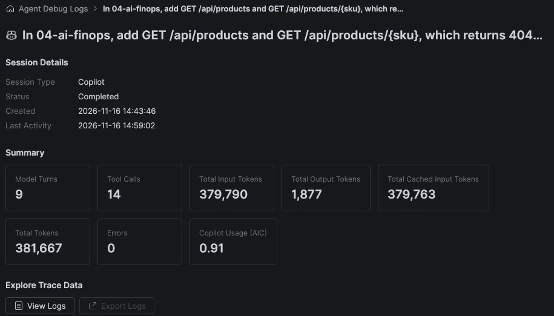
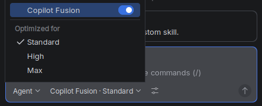
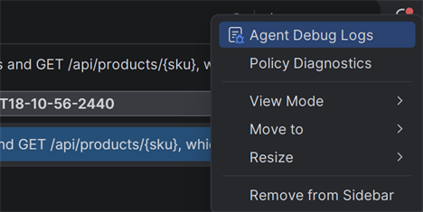

# Lesson 4: AI FinOps

**What does a task cost?** · Part 4 of 5 · [All lessons](../README.md)

Every Copilot task has a cost, counted in AI credits. The cost depends on how much work the task takes: how many times Copilot calls a model, how much text goes back and forth, and which models do the work. A higher effort level can give a better answer, but it usually costs more.

In this lesson, you measure what one task costs, and see how one setting changes it.

## The problem

Your manager asks what a Copilot task costs. Find out: give Copilot the same small task twice, with two different settings, each in its own **Worktree** session, and compare. Don't apply the first run until you've finished the second, then apply only the higher-effort run, so the second run doesn't start with the first run's code. Tell Copilot not to change the tests.

The task is a JSON API for the store:

- `GET /api/products` returns all six products, as a JSON array.
- `GET /api/products/{sku}` returns one product, or 404 when there's no such product.

Each product has a `sku`, `name`, `price` and `stock`. For example, `/api/products/BOT-001` returns `{"sku":"BOT-001","name":"Ridge Hiking Boots","price":129,"stock":8}`.

## Core concepts

### What a task costs

Models read and write text in tokens, which are small pieces of words. Copilot doesn't do a task in one request: it works in model turns. In each turn, it sends the model the conversation so far, including the files it read and the results of its tool calls, such as running the tests. The model replies with an answer, or asks for another tool call. So each turn usually sends more tokens than the last, and the total grows quickly. The cost depends on two things: the number of tokens, and the model, because each model has its own price per token. Copilot adds it all up in AI credits.

### Copilot Fusion

With Fusion, you don't pick a model. You pick an effort level, and Copilot picks the models, and how to use them: one model for a task, or one that drafts and others that check its work. The Fusion picker shows **Standard**, **High** and **Max**. In this lesson, if you have Fusion, compare Standard and Max. Max can use stronger models, and more than one per task, so it usually costs more: even for this small task, it can cost tens of AI credits. Turn on **Fusion** in the model picker, in the chat box.

Fusion is still rolling out, and it isn't in every plan. If it isn't in yours, leave it off, or turn it off. Pick a model, and compare it at two effort levels, such as **Medium** and **Max**, or compare two models at the same effort level. The per-model effort picker offers **Low**, **Medium**, **High**, **Extra High** and **Max**: a higher level lets the model reason for longer before it answers, which uses more tokens. See [About GitHub Copilot Fusion](https://docs.github.com/en/copilot/concepts/models/copilot-fusion).

### Agent debug logs

Agent debug logs show what each session used: its model turns, tool calls, tokens and AI credits. Open them from the Options menu at the top of Chat, and copy these fields from the **Summary** into [cost-report.md](cost-report.md): **Model Turns**, **Tool Calls**, **Total Tokens** and **Copilot Usage (AIC)**.



### A fair comparison

To compare two runs, change only one setting, such as the effort level. Both runs get the same prompt, and start from the same code. A worktree session starts from your last commit, and **Apply** copies a session's changes into your project, without committing them to your branch. So if you applied run 1 before you started run 2, run 2's **Uncommitted Changes** card would offer to copy run 1's code into its worktree, and run 2 would have less to do. That's why each run gets its own worktree, and you apply only after both are done.

### OpenTelemetry, optional

The agent debug logs give you each session's totals. A trace shows the steps behind them. OpenTelemetry is an open standard for traces: records of what a program did, step by step, and how long each step took. Copilot can send a trace of each session to a viewer, such as the Aspire dashboard. It needs Docker, installed and running. Start the viewer with [observability/docker-compose.yml](observability/docker-compose.yml), and turn on the export in Settings → GitHub Copilot → Chat → Open Telemetry. The viewer has no sign-in, so the file publishes it on `127.0.0.1` only: open http://localhost:18888 on the same computer. When you're done, stop it with `docker compose down` in the `observability` folder. See [OpenTelemetry for agent monitoring](https://docs.github.com/en/copilot/concepts/enterprise/opentelemetry).

## Get started

Run the tests:

```bash
cd 04-ai-finops
./mvnw -B -ntp verify
```

On Windows, use `.\mvnw.cmd -B -ntp verify`. Two tests in `ApiTests` fail: the list, and finding one product. The 404 test already passes, because there's no API yet. Both runs have the same finish line: all three pass.

## Try it

You run the same prompt twice, in two worktree sessions: first at a standard effort level, then at Max. After each run, you copy its numbers from the agent debug logs. When both are done, you apply the Max run, and compare the two.

Write your own prompt: step 1 says what to ask for. Name the lesson's folder, `04-ai-finops`, in it, so Copilot knows which lesson you mean. Keep a copy: for a fair comparison, you send exactly the same prompt in run 2. If you're stuck, open **A prompt that works**, under step 1.

1. **Run 1.** At the top of Chat, click **+**. In the row under the chat box, click **Workspace**, and choose **Worktree**. In the model picker, turn on **Fusion**, if it isn't on already, and choose **Standard**. Without Fusion, pick a model, and choose **Medium**.

   

   Then ask Copilot to add the two endpoints from [The problem](#the-problem), and to make `ApiTests` pass without changing the tests.

   <details>
   <summary>A prompt that works</summary>

   > In 04-ai-finops, add GET /api/products and GET /api/products/{sku}, which returns 404 for an unknown SKU. Make ApiTests pass. Don't change the tests.

   </details>

   If an **Uncommitted Changes** card appears, click the arrow next to **Copy Changes**, and choose **Skip Changes**: the worktree starts from your last commit.

2. **Read its cost.** When Copilot is done, open **Agent Debug Logs** from the Options menu at the top of Chat, and pick the newest session.

   

   Copy the four **Summary** fields into [cost-report.md](cost-report.md). Don't click **Apply** yet.

3. **Run 2.** Start another new session, and check that it's in **Worktree** mode: it usually keeps the last session's choice. Choose Fusion **Max**, or the same model at **Max**. Send exactly the same prompt as in run 1, and if the **Uncommitted Changes** card appears, skip the changes again. When Copilot is done, copy its numbers too: in the **Agent Debug Logs** tab, go back to the list of sessions, and pick the newest. The **Summary** doesn't name the model: for the **Model** column, write the setting you chose, such as Fusion Max.

4. **Apply run 2.** In the Max session, click **Apply**, above the chat box. There's no confirmation: the list of changed files just closes. Then run the tests again: they all pass.

5. **Compare.** Which run used more **Copilot Usage (AIC)**, and why? Look at the model turns, tool calls and tokens. Max usually costs more, but not always.

<details>
<summary>Hints</summary>

The Java files are in `src/main/java/com/contoso/store`. The `all()` method in `Catalog.java` already returns the products, and `Product` already has the four fields.

A new `@RestController` for `/api/products` keeps the store's page as it is. Read the SKU with `@PathVariable`. `ResponseEntity.of(...)` returns 404 for an empty `Optional`. `ApiTests.java` shows the values the tests expect.

The **Credits** below Copilot's answer are the same unit as **Copilot Usage (AIC)**.

If Copilot can't run Maven, and the output says `Access is denied`, the sandbox from lesson 3 is on. In Settings → GitHub Copilot → Sandbox, turn off **Enable Sandbox by default for new Copilot sessions**, and start the run again in a new session.

For traces of both runs, set up OpenTelemetry (optional) before run 1: turning on the export needs an IntelliJ restart. To restart, choose Help → Find Action, type `Restart IDE`, and press Enter.

</details>

## Done when

- [ ] All the tests pass.
- [ ] [cost-report.md](cost-report.md) has the numbers for both runs.
- [ ] You can say which run cost more, and why.

Stuck? Read the [solution](SOLUTION.md).

---

[← Back to the start](../README.md) · [Next lesson: App modernization →](../05-app-modernization/README.md)
