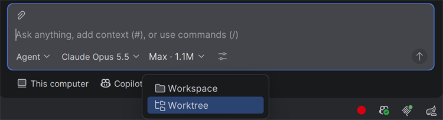
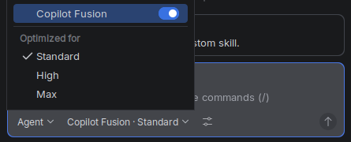
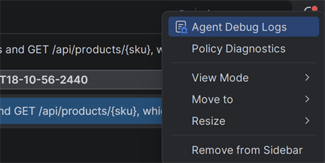
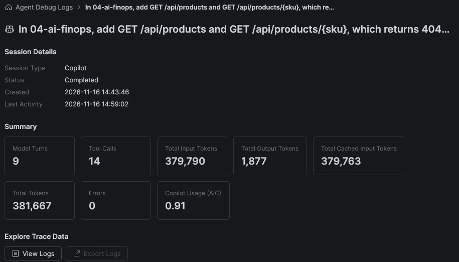
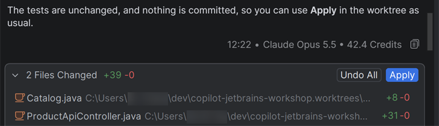
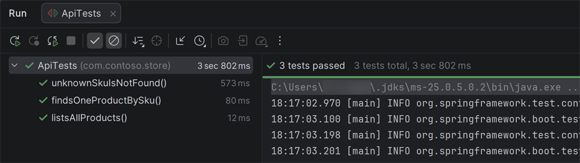
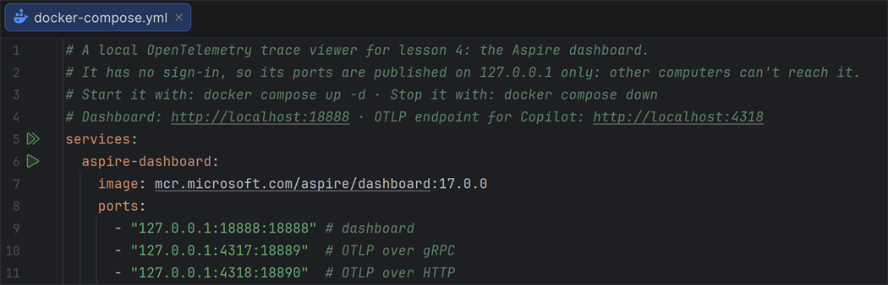
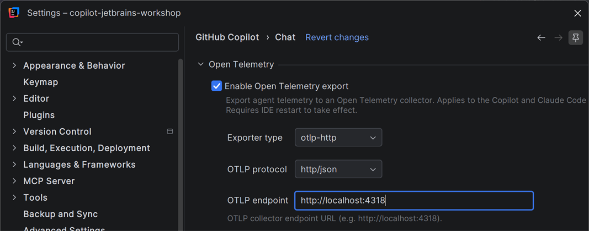
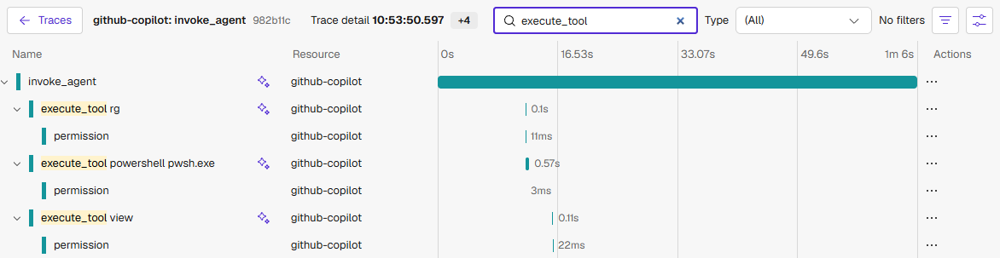

# Lesson 4 solution: What does a task cost?

**AI FinOps** · Part 4 of 5 · [The challenge](README.md) · [All lessons](../README.md)

Your manager wants to know what a Copilot task costs. The honest answer is a measurement: run a real task, read what it used, and change one setting to see how the cost moves. This solution runs the same small task, a JSON API for the store, at two effort levels, records each run's numbers, and compares them.

## Core concepts

**AI credits are the unit.** Each token a task uses has a price, which depends on the model, and Copilot adds up the cost in AI credits (AIC). The **Credits** below Copilot's answer and **Copilot Usage (AIC)** in the agent debug logs are the same unit.

**A task is a loop of turns.** In each model turn, Copilot sends the model the conversation so far, and the model replies with an answer or a tool call, such as reading a file or running the tests. The tool's result joins the conversation, and the next turn sends it all again. So tokens add up quickly: the more turns and tool calls a task takes, the more each new turn carries.

**Effort changes how much work goes into an answer.** With Fusion, the effort level decides how Copilot uses models. At Standard, it picks one model for the task. At Max, it can use stronger models, and more than one: one that writes the code, and others that check it. Fusion adds model calls only when a task needs them, so Max usually costs more, but not always. Without Fusion, a model's effort level sets how long it reasons before it answers.

**Change one thing at a time.** A fair comparison changes only one setting, such as the effort level. Both runs get the same prompt, and each starts in its own worktree, from your last commit. **Apply** copies a run's changes into your project, without committing them to your branch, so apply nothing until both runs are done: otherwise run 2's **Uncommitted Changes** card offers to copy run 1's code into its worktree.

## The plan

Run the task twice, each time in a new worktree session: first at Standard, then at Max. After each run, copy its numbers from the agent debug logs into [cost-report.md](cost-report.md). When both are done, apply only the Max run, run the tests, and compare the two. To see traces of both runs too, do the optional [step 6](#6-see-the-traces-optional) first: turning on the export needs an IntelliJ restart.

## 1. Run 1: Standard effort

Run 1 is your baseline: the task at everyday effort. Each run starts in a new worktree, from your last commit, so both start from the same code. If an **Uncommitted Changes** card appears when you send the prompt, click the arrow next to **Copy Changes**, and choose **Skip Changes**.

If you turned on the sandbox in lesson 3, turn it off first: in Settings → GitHub Copilot → Sandbox, untick **Enable Sandbox by default for new Copilot sessions**. In the sandbox, Copilot can't run Maven, so it can't run the tests.

1. At the top of Chat, click **+** to start a new session. In the row under the chat box, click **Workspace** and choose **Worktree**.

   

2. Open the model picker in the chat box. If you have **Fusion**, turn it on, and choose **Standard**. The Fusion picker also offers **High**. In this lesson, with Fusion, you use **Standard** and **Max**.

   If Fusion isn't there, pick a model, and choose **Medium**. The per-model effort picker offers **Low**, **Medium**, **High**, **Extra High** and **Max**.

   

3. Send:

   > In 04-ai-finops, add GET /api/products and GET /api/products/{sku}, which returns 404 for an unknown SKU. Make ApiTests pass. Don't change the tests.

## 2. Read the cost

Copilot's answer shows what it built. The agent debug logs show what it used.

When Copilot is done, open **Agent Debug Logs** from the Options menu at the top of Chat, and pick the newest session. Copy these numbers from its **Summary** into [cost-report.md](cost-report.md): **Model Turns**, **Tool Calls**, **Total Tokens** and **Copilot Usage (AIC)**.

Below Copilot's answer, the chat footer shows **Credits**. That's the same unit as **Copilot Usage (AIC)**: AI credits.





*The Summary of one run, on Fusion Standard.*

Don't click **Apply** yet: run 2 must start from the same code as run 1.

## 3. Run 2: Max effort

Now run the same task again, with one setting changed.

Start another new session in **Worktree** mode. If you used Fusion for run 1, choose Fusion **Max**. If you used a single model, keep that model and choose **Max**, or pick a second model at the same effort level. Send the same prompt, and record its numbers. With Fusion, Max can cost tens of AI credits, even for this small task. If the **Agent Debug Logs** tab still shows run 1, click **Agent Debug Logs** at the top of the tab to go back to the list of sessions, and pick the newest.

## 4. Keep the higher-effort run

With both runs recorded, you can choose which code to keep, and bring it into your project.

Open the Max session (or your higher-effort session). Above the chat box, it lists every file it changed, such as a new controller and `Catalog.java`. Click **Apply** to copy them all into your project. There's no confirmation: the list just closes. Don't apply the first run.



*Copilot's changes vary from run to run, so your file names might differ.*

Then run `./mvnw -B -ntp verify` again, or click the green run icon next to `ApiTests`. The tests pass.



## 5. Compare

Put the two runs side by side in [cost-report.md](cost-report.md). Which used more **Copilot Usage (AIC)**? Then look for the reason: did that run take more model turns, or more tool calls? Did its tokens add up faster?

With Fusion, Max can use stronger models, and more than one model for a task, such as one that writes the code and others that check it. So it usually costs more, but not always. A higher effort level on one model usually costs more too. Each turn sends the whole conversation to the model again, so the token count grows quickly. If you used Fusion, hover over the effort level below Copilot's answer to see which models it used.

So what does a task cost? It depends on the task, the effort level, the models, and how many turns the run takes. Your two runs are the answer for this task. To answer for your team, measure the tasks it does most, the same way.

## 6. See the traces (optional)

The agent debug logs give you each session's totals. A trace shows the steps behind them: each tool call, in order, and how long it took.

This needs Docker, installed and running.

1. Open `observability/docker-compose.yml`, and click the run icon next to `services:`. In the **Edit Run Configuration** dialog that opens, click **Run**. Or run `docker compose up -d` in the `observability` folder.

   

2. In Settings → GitHub Copilot → Chat → Open Telemetry, turn on **Enable Open Telemetry export**, set **OTLP endpoint** to `http://localhost:4318`, and restart IntelliJ: choose Help → Find Action, type `Restart IDE`, and press Enter.

   

3. Run a session, then open the Aspire dashboard at <http://localhost:18888>, and choose **Traces**. In a trace, each `execute_tool` span is one tool call, such as `execute_tool view`. To list only those, type `execute_tool` in the **Filter** box above the spans, next to **Type**. The **Filter** box on the left filters the telemetry sources, not the spans.

   

   *Run 1's trace, filtered on `execute_tool`. The tool names depend on the model.*

When you're done, stop the dashboard with `docker compose down`, and turn off the export.

## What you used

You turned a vague question into a measurement: the same task, two effort levels, and the numbers from each run.

- **GitHub Copilot:** Copilot Fusion or the model picker, worktree sessions, **Apply**, Agent Debug Logs, OpenTelemetry export.
- **IntelliJ IDEA:** running `docker-compose.yml` from the editor, the test runner.

## The code

Copilot's code may look different. That's fine, as long as the tests pass.

`ProductApiController.java`, next to `Catalog.java`:

```java
package com.contoso.store;

import java.util.List;
import org.springframework.http.ResponseEntity;
import org.springframework.web.bind.annotation.GetMapping;
import org.springframework.web.bind.annotation.PathVariable;
import org.springframework.web.bind.annotation.RequestMapping;
import org.springframework.web.bind.annotation.RestController;

@RestController
@RequestMapping("/api/products")
class ProductApiController {

    private final Catalog catalog;

    ProductApiController(Catalog catalog) {
        this.catalog = catalog;
    }

    @GetMapping
    List<Product> all() {
        return catalog.all();
    }

    @GetMapping("/{sku}")
    ResponseEntity<Product> one(@PathVariable String sku) {
        return ResponseEntity.of(catalog.all().stream()
                .filter(product -> product.sku().equals(sku))
                .findFirst());
    }
}
```

---

[← Back to the start](../README.md) · [Next lesson: App modernization →](../05-app-modernization/README.md)
