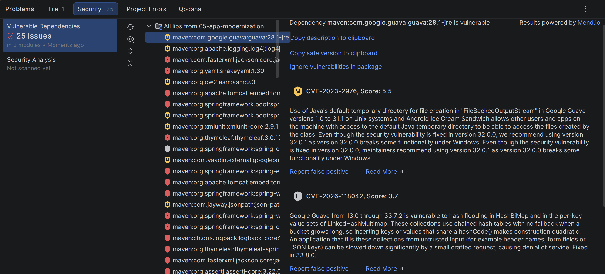
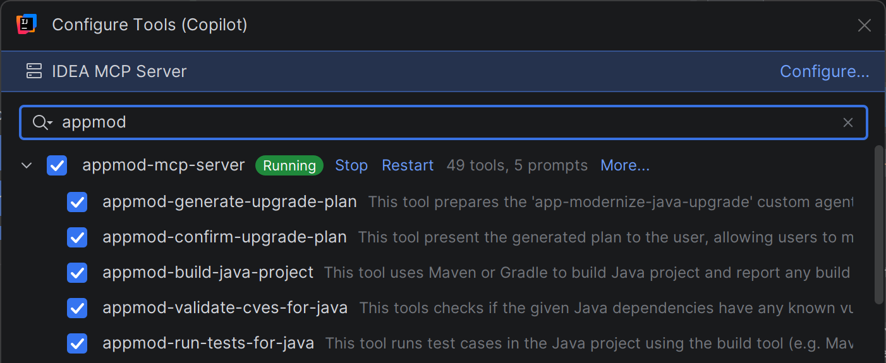
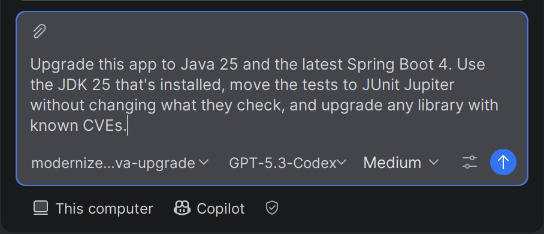

# Lesson 5: App modernization

**An old app, a new home** · Part 5 of 5 · [All lessons](../README.md)

Old apps get harder to run and to keep secure as Java and its libraries move on. Old versions stop getting free fixes, new vulnerabilities turn up in old libraries, and the jump to a current version grows every year.

In this lesson, you let Copilot move one to a new home: the latest Java and Spring Boot. Copilot plans the upgrade and makes it step by step, and you check its work with IntelliJ.

## The problem

This lesson's Trail Store is an old copy, on Java 8, Spring Boot 2.7 and JUnit 4. It still builds, but Spring Boot 2.7 stopped getting free updates in 2023, and many of its libraries have known vulnerabilities (CVEs). Move it to Java 25, Spring Boot 4 and JUnit Jupiter, without rewriting it.

The store must still show the same six products, and both tests must still check what they check now.

## Core concepts

### What an upgrade changes

An upgrade this big is more than new version numbers in `pom.xml`:

- **Java 8 to 25.** Java 25 is the latest long-term support release, so it gets fixes for years.
- **Spring Boot 2.7 to 4.** Spring Boot 3 moved from the old `javax` packages to Jakarta EE's `jakarta` packages, so imports change. Spring Boot 4 moves some classes again, and brings newer versions of the libraries it manages.
- **JUnit 4 to JUnit Jupiter.** The tests get new imports and annotations. The old app runs its JUnit 4 tests through the JUnit Vintage engine, which the upgrade usually removes. A test that doesn't move may not run at all, and a build with no tests can still pass.

Each change can break the build, so an upgrade goes best in small steps, with a build and the tests after each one.

### GitHub Copilot modernization

A separate plugin, by Microsoft, that upgrades Java apps. By hand, an upgrade means chasing every renamed package, changed API and new library version. With the plugin, Copilot writes an upgrade plan, changes the code step by step, builds and tests after each step, and checks the libraries for known CVEs. It adds the **GitHub Copilot modernization** tool window on the left, and a **modernize-java-upgrade** agent to the chat. It works with any GitHub Copilot plan, and upgrades don't need an Azure account. See [Quickstart: Upgrade a Java Project with GitHub Copilot Modernization](https://learn.microsoft.com/en-us/azure/developer/github-copilot-app-modernization/quickstart-upgrade).

### Direct and transitive dependencies

`pom.xml` lists the libraries the app asks for: its direct dependencies. Each of them brings in libraries of its own, its transitive dependencies. Spring Boot's starters bring in dozens, for logging, JSON and more. A vulnerability can be in any of them. To fix a library you didn't ask for, you pin a fixed version in your own `pom.xml`. If there's no fix, you exclude the library, and add a replacement if the app needs one.

### Vulnerable dependencies

IntelliJ checks your libraries against known vulnerabilities, with data from Mend.io and OSV. It highlights vulnerable ones in `pom.xml`, and Code → Analyze Code → **Vulnerable Dependencies** lists them all, transitive ones included. Use it to check the upgrade yourself: Copilot's own CVE check can miss some. See [Find vulnerable and malicious dependencies](https://www.jetbrains.com/help/idea/package-analysis.html) in the IntelliJ IDEA docs.

## Get started

- Open the `05-app-modernization` folder as its own project: choose File → Open, and select the folder. If IntelliJ asks where to open it, click **New Window**. The upgrade changes the whole project, so this keeps the other lessons out of it.
- In File → Project Structure → Project, set **SDK** to JDK 25.
- Check that it builds: in the terminal, run `.\mvnw.cmd verify` (on macOS and Linux, `./mvnw verify`). It passes on Java 25, but the code still targets Java 8.
- Install the plugin: in Settings → Plugins, search for **GitHub Copilot modernization**, click **Install**, and restart IntelliJ, so that its agent appears in the chat.

Use version 1.14.1 or later of the plugin. With IntelliJ 2026.3, version 1.14.0 stops IntelliJ's terminal from starting ([known issue](https://github.com/microsoft/github-copilot-appmod/issues/213)): if you have it, update it in Settings → Plugins, and restart IntelliJ.

## Try it

You check, upgrade, then check again. First, see which libraries are vulnerable now. Then let the modernization agent plan and make the upgrade. Last, check its work with IntelliJ, ask Copilot to fix anything it missed, and run the app.

1. **See what's vulnerable.** Choose Code → Analyze Code → **Vulnerable Dependencies**. Its **Security** tab lists the old libraries with known CVEs. That's your starting point, to compare with after the upgrade.

   

2. **Turn on the plugin's tools.** In the chat box, click **Configure tools** (the sliders icon), and search for `appmod`. If **appmod-mcp-server** says **Stopped**, click **Start**: you can't tick it while it's stopped. Make sure it's ticked, then click **Apply**.

   

3. **Ask for the upgrade.** Start a new chat, and choose the **modernize-java-upgrade** agent. Under the chat box, make sure it says **Copilot**, not **Local**. Then send:

   > Upgrade this app to Java 25 and the latest Spring Boot 4. Use the JDK 25 that's installed, move the tests to JUnit Jupiter without changing what they check, and upgrade any library with known CVEs.

      

      Copilot writes a plan, `plan.md`, in a new folder under `.github/modernize/java-upgrade/`, then upgrades in steps. It can take 8 to 15 minutes. At the end, it writes `summary.md` next to the plan.

4. **Check the libraries yourself.** Click **Keep All**, press **Ctrl+Shift+O** to load the Maven changes, and run **Vulnerable Dependencies** again. Copilot's CVE check only looks at the libraries in `pom.xml`, so it can miss the ones that Spring Boot brings in, and its data can differ from IntelliJ's. If any are left, send this prompt, but change the number and the names to the libraries that your check finds:

   > IntelliJ's Vulnerable Dependencies check still finds 5 vulnerable libraries that Spring Boot brings in: logback-classic, jackson-databind, json-smart, asm and android-json. Override each one with a version that fixes its CVEs, or exclude it if there's no fix, and keep the tests passing.

5. **Run the tests and the store.** Run `.\mvnw.cmd verify` (on macOS and Linux, `./mvnw verify`): both tests run and pass. Then, in `StoreApplication.java`, click the green **Run** arrow next to `main`, and choose **Run 'StoreApplication.main()'**. <http://localhost:8080> shows the six products, and Spring Boot 4. Stop the store with the red **Stop** button in the **Run** tool window.

Hints

The upgrade usually changes these files:

| File | What changes |
|---|---|
| `pom.xml` | Java 25, Spring Boot 4, newer libraries, and no JUnit Vintage engine. |
| `Catalog.java`, `StoreController.java` | The `javax` imports become `jakarta`. |
| `CatalogTest.java`, `StoreApplicationTests.java` | The JUnit 4 imports become JUnit Jupiter, `@RunWith(SpringRunner.class)` goes, and `AutoConfigureMockMvc` moves to a new package. The checks stay the same. |

If **modernize-java-upgrade** isn't in the agent list, check in Settings → Plugins that **GitHub Copilot modernization** is installed and turned on, then restart IntelliJ.

If Copilot tries to download another JDK, and the download fails, tell it to use JDK 25 for every step.

If the build says `Tests run: 0`, the tests didn't move to JUnit Jupiter. Ask Copilot to fix that, without removing any test.

Your libraries, versions and CVE counts can differ from the solution's: the vulnerability data changes.

If Copilot can't run Maven, and the output says `Access is denied`, the sandbox from lesson 3 is on. In Settings → GitHub Copilot → Sandbox, turn off **Enable Sandbox by default for new Copilot sessions**, and start a new chat.

## Done when

- [ ] `pom.xml` uses Java 25 and Spring Boot 4.
- [ ] Both tests use JUnit Jupiter, still check what they checked before, and pass: `.\mvnw.cmd verify`.
- [ ] Code → Analyze Code → **Vulnerable Dependencies** finds no vulnerable libraries.
- [ ] With the store running, http://localhost:8080 shows the six products, and Spring Boot 4.
- [ ] You can say why IntelliJ's check found vulnerable libraries that Copilot's check missed.

Stuck? Read the [solution](SOLUTION.md).

---

[← Back to the start](../README.md)
