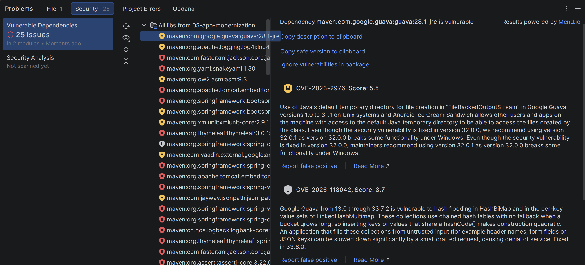
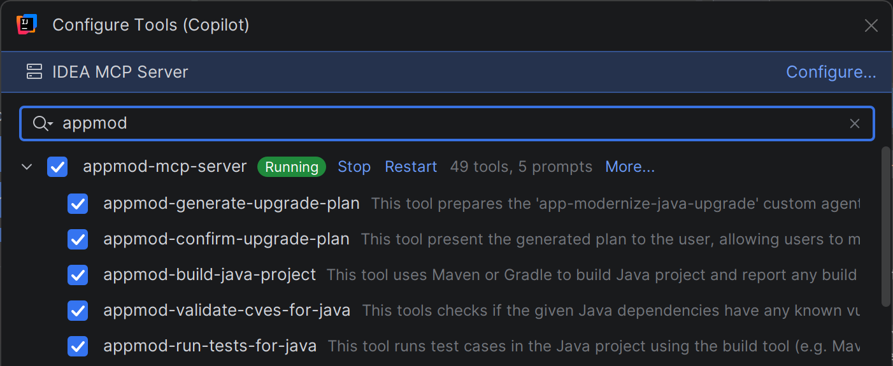
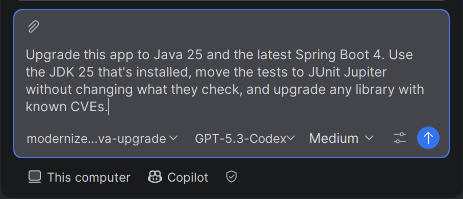
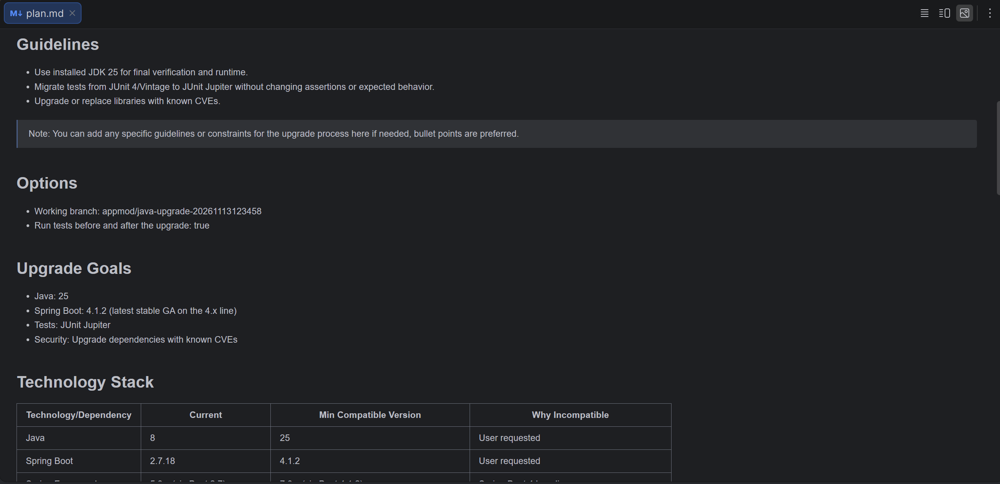
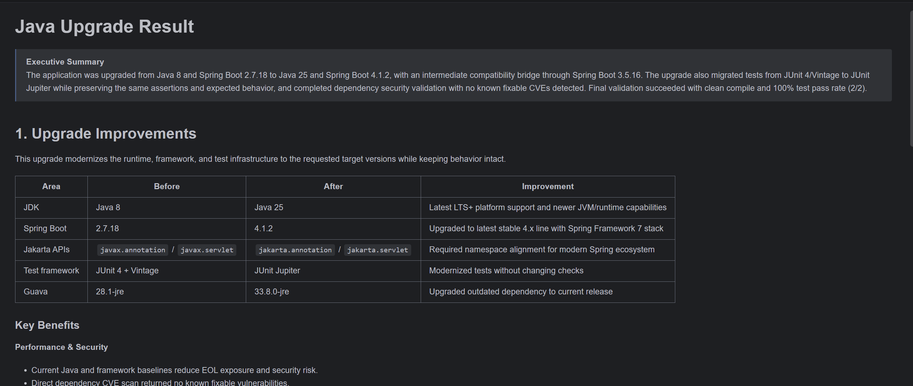
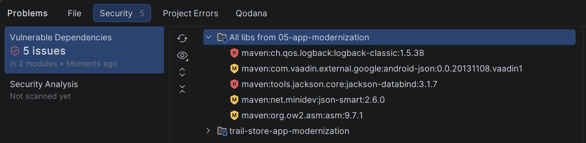
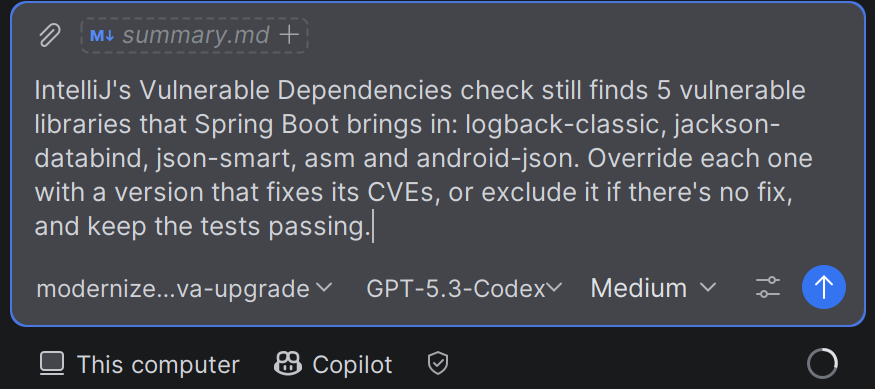
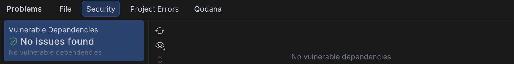
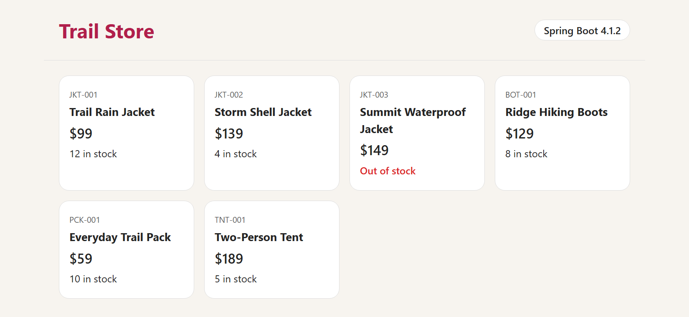

# Lesson 5 solution: An old app, a new home

**App modernization** · Part 5 of 5 · [The challenge](README.md) · [All lessons](../README.md)

This lesson's Trail Store runs on Java 8, Spring Boot 2.7 and JUnit 4, with libraries that have known vulnerabilities. This solution upgrades it with GitHub Copilot modernization, checks the result with IntelliJ, and closes the gaps that Copilot's own check misses.

## Core concepts

**An upgrade is a chain of changes.** Spring Boot 4 needs a newer Java, newer libraries and the `jakarta` packages instead of `javax`, and some of Spring's test classes have moved to new packages. Each change can break the build, so it pays to make them in small steps, and to build and test after each one.

**A plan comes before the code.** The modernization agent doesn't start by editing. It writes a plan, `plan.md`, with the goals and each library's current and new version. Then it upgrades in steps, and builds and tests after each one. At the end, `summary.md` says what changed. Its tools come from **appmod-mcp-server**, an MCP server that the plugin adds.

**Direct and transitive dependencies.** `pom.xml` lists the libraries the app asks for. Those bring in more libraries of their own: Spring Boot's starters bring in logging, JSON and test libraries. Copilot's CVE check looks only at the libraries in `pom.xml`. IntelliJ's Vulnerable Dependencies check looks at them all.

**Pin or exclude.** You can't fix a library you didn't ask for by editing the library that brings it in. Instead, you pin a fixed version in your own `pom.xml`, under `dependencyManagement`, which overrides the version that Spring Boot asks for. If there's no fixed version, you exclude the library, and add a replacement if the app needs one.

**A passing build isn't enough.** A build can pass with no tests at all. Check that both tests ran, and that they still check what they did before.

## The plan

Check, upgrade, then check again. First, IntelliJ's Vulnerable Dependencies check gives you a starting point. Then the modernization agent plans the upgrade, and makes it step by step. When it's done, you run the same IntelliJ check, ask Copilot to fix what's left, and run the tests and the store.

## The steps

Before you start, open `05-app-modernization` in its own window, and install the **GitHub Copilot modernization** plugin, as in the README. If you turned on the sandbox in lesson 3, turn it off: in Settings → GitHub Copilot → Sandbox, untick **Enable Sandbox by default for new Copilot sessions**. In the sandbox, Copilot can't run Maven.

1. **See what's vulnerable.** Choose Code → Analyze Code → **Vulnerable Dependencies**. The Problems tool window opens on its **Security** tab: in this run, the old app had 25 issues. Click a library to see its CVEs. That's your starting point, to compare with after the upgrade.

   

2. **Turn on the plugin's tools.** In the chat box, click **Configure tools** (the sliders icon), and search for `appmod`. If **appmod-mcp-server** says **Stopped**, click **Start**: you can't tick it while it's stopped. Make sure it's ticked, then click **Apply**. With these tools, Copilot plans the upgrade, builds the app, runs the tests and checks for CVEs.

   

3. **Ask the upgrade agent.** Start a new chat, and choose the **modernize-java-upgrade** agent. If it isn't in the list, check in Settings → Plugins that **GitHub Copilot modernization** is turned on, and restart IntelliJ. Under the chat box, make sure it says **Copilot**, not **Local**. Then send:

   > Upgrade this app to Java 25 and the latest Spring Boot 4. Use the JDK 25 that's installed, move the tests to JUnit Jupiter without changing what they check, and upgrade any library with known CVEs.

   The prompt sets the targets, and the limits: use the JDK you already have, keep what the tests check, and fix known CVEs.

   

   The **Upgrade Runtime & Frameworks** button in the tool window starts an upgrade too, but in a **Local** chat, which runs its commands in IntelliJ's terminal. Version 1.14.0 of the plugin stops that terminal from starting, so the chat stops at its first command ([known issue](https://github.com/microsoft/github-copilot-appmod/issues/213)). Version 1.14.1 fixes the terminal.

4. **Check the plan.** Before it changes any code, Copilot writes an upgrade plan, `plan.md`, in a new folder under `.github/modernize/java-upgrade/`: your guidelines, the goals, and each library's current and new version. Check that the goals match your prompt. Then it upgrades in steps, sometimes through Spring Boot 3.5 on the way, and builds the app after each step. It may also make a branch, `appmod/java-upgrade-<id>`, and commit each step, so you can review or undo each one.

   

   If Copilot tries to download another JDK for a step, and the download fails, tell it to use JDK 25 for every step.

5. **Read the summary.** At the end, Copilot checks the libraries for known CVEs, runs the tests, and writes `summary.md` next to the plan. In this run, the upgrade took about 8 minutes. Make sure the summary says the build and tests passed, and that the tests still check what they did before.

   

6. **Check the libraries yourself.** Copilot's summary says what it did. An independent check shows what's left. Click **Keep All**, press Ctrl+Shift+O to load the Maven changes, and run Vulnerable Dependencies again. Copilot's CVE check only looks at the libraries in `pom.xml`, so it misses the ones that Spring Boot brings in, and its data can differ from IntelliJ's. In this run, 5 were left:

   

   Send this prompt, but change the number and the names to the libraries that your check finds:

   > IntelliJ's Vulnerable Dependencies check still finds 5 vulnerable libraries that Spring Boot brings in: logback-classic, jackson-databind, json-smart, asm and android-json. Override each one with a version that fixes its CVEs, or exclude it if there's no fix, and keep the tests passing.

   

   Copilot pins fixed versions in `pom.xml`, and swaps android-json, which has no fix, for org.json. Click **Keep All**, press Ctrl+Shift+O, and run the check again.

   

7. **Run the tests and the store.** Last, check that the app still does its job. Run `.\mvnw.cmd verify` (on macOS and Linux, `./mvnw verify`): both tests run and pass, and the build says `Tests run: 2`. Then open `src/main/java/com/contoso/store/StoreApplication.java`, click the green **Run** arrow next to `main`, and choose **Run 'StoreApplication.main()'**. http://localhost:8080 shows the six products, and Spring Boot 4. Stop the store with the red **Stop** button in the **Run** tool window.

   

## What you used

The app moved from Java 8 to 25, and from Spring Boot 2.7 to 4, without a rewrite. Copilot planned and made the upgrade, and IntelliJ's check found what Copilot's own check missed.

- **GitHub Copilot modernization**: its **modernize-java-upgrade** agent plans the upgrade, changes the code in steps, and builds and tests the app after each step. Its **appmod-mcp-server** tools do the planning, building, testing and CVE check. The plan, progress and summary are in `.github/modernize/java-upgrade/`.
- **Vulnerable dependencies**: IntelliJ's own check of your libraries, with data from Mend.io. It also finds the libraries that other libraries bring in.

## The code

Copilot's changes, after both prompts. Yours can differ: Copilot can pick other versions, or another fix for the same CVE. What matters is that the README's checks pass.

`pom.xml`:

```xml
<?xml version="1.0" encoding="UTF-8"?>
<project xmlns="http://maven.apache.org/POM/4.0.0"
         xmlns:xsi="http://www.w3.org/2001/XMLSchema-instance"
         xsi:schemaLocation="http://maven.apache.org/POM/4.0.0 https://maven.apache.org/xsd/maven-4.0.0.xsd">
    <modelVersion>4.0.0</modelVersion>
    <parent>
        <groupId>org.springframework.boot</groupId>
        <artifactId>spring-boot-starter-parent</artifactId>
        <version>4.1.2</version>
        <relativePath/>
    </parent>
    <groupId>com.contoso</groupId>
    <artifactId>trail-store-app-modernization</artifactId>
    <version>1.0.0</version>
    <name>Trail Store - Lesson 5: App modernization</name>
    <properties>
        <java.version>25</java.version>
        <jackson.databind.version>3.1.8</jackson.databind.version>
        <logback.classic.version>1.6.6</logback.classic.version>
        <json.smart.version>2.6.1</json.smart.version>
        <asm.version>9.11.1</asm.version>
        <org.json.version>20260814</org.json.version>
    </properties>
    <dependencyManagement>
        <dependencies>
            <dependency>
                <groupId>tools.jackson.core</groupId>
                <artifactId>jackson-databind</artifactId>
                <version>${jackson.databind.version}</version>
            </dependency>
            <dependency>
                <groupId>ch.qos.logback</groupId>
                <artifactId>logback-classic</artifactId>
                <version>${logback.classic.version}</version>
            </dependency>
            <dependency>
                <groupId>ch.qos.logback</groupId>
                <artifactId>logback-core</artifactId>
                <version>${logback.classic.version}</version>
            </dependency>
            <dependency>
                <groupId>net.minidev</groupId>
                <artifactId>json-smart</artifactId>
                <version>${json.smart.version}</version>
            </dependency>
            <dependency>
                <groupId>org.ow2.asm</groupId>
                <artifactId>asm</artifactId>
                <version>${asm.version}</version>
            </dependency>
        </dependencies>
    </dependencyManagement>
    <dependencies>
        <dependency>
            <groupId>org.springframework.boot</groupId>
            <artifactId>spring-boot-starter-web</artifactId>
        </dependency>
        <dependency>
            <groupId>org.springframework.boot</groupId>
            <artifactId>spring-boot-starter-thymeleaf</artifactId>
        </dependency>
        <dependency>
            <groupId>com.google.guava</groupId>
            <artifactId>guava</artifactId>
            <version>33.8.0-jre</version>
        </dependency>
        <dependency>
            <groupId>org.springframework.boot</groupId>
            <artifactId>spring-boot-starter-test</artifactId>
            <scope>test</scope>
            <exclusions>
                <exclusion>
                    <groupId>com.vaadin.external.google</groupId>
                    <artifactId>android-json</artifactId>
                </exclusion>
            </exclusions>
        </dependency>
        <dependency>
            <groupId>org.springframework.boot</groupId>
            <artifactId>spring-boot-starter-webmvc-test</artifactId>
            <scope>test</scope>
            <exclusions>
                <exclusion>
                    <groupId>com.vaadin.external.google</groupId>
                    <artifactId>android-json</artifactId>
                </exclusion>
            </exclusions>
        </dependency>
        <dependency>
            <groupId>org.json</groupId>
            <artifactId>json</artifactId>
            <version>${org.json.version}</version>
            <scope>test</scope>
        </dependency>
    </dependencies>
    <build>
        <plugins>
            <plugin>
                <groupId>org.springframework.boot</groupId>
                <artifactId>spring-boot-maven-plugin</artifactId>
            </plugin>
        </plugins>
    </build>
</project>
```

In `Catalog.java` and `StoreController.java`, `javax` becomes `jakarta`:

```diff
-import javax.annotation.PostConstruct;
+import jakarta.annotation.PostConstruct;

-import javax.servlet.http.HttpServletResponse;
+import jakarta.servlet.http.HttpServletResponse;
```

In `CatalogTest.java` and `StoreApplicationTests.java`, JUnit 4 becomes JUnit Jupiter, and `AutoConfigureMockMvc` moves to a new package:

```diff
-import static org.junit.Assert.assertEquals;
+import static org.junit.jupiter.api.Assertions.assertEquals;

-import org.junit.Test;
+import org.junit.jupiter.api.Test;

-import org.junit.runner.RunWith;
-import org.springframework.test.context.junit4.SpringRunner;
-@RunWith(SpringRunner.class)

-import org.springframework.boot.test.autoconfigure.web.servlet.AutoConfigureMockMvc;
+import org.springframework.boot.webmvc.test.autoconfigure.AutoConfigureMockMvc;
```

That's the end of the workshop.

---

[← Back to the start](../README.md)