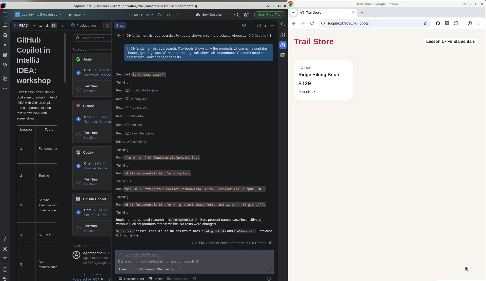

# GitHub Copilot in IntelliJ IDEA: workshop

Each lesson has a simple challenge to solve in IntelliJ IDEA with GitHub Copilot, and a separate solution that shows how, with screenshots.

<p align="center"></p>

| Lesson | Topic | Features | Challenge | Solution |
|---|---|---|---|---|
| 1 | Fundamentals | Parallel sessions and worktrees, next edit suggestions | [Two features at once](01-fundamentals/README.md) | [Solution](01-fundamentals/SOLUTION.md) |
| 2 | Tooling | Customization panel, built-in MCP server, browser use | [Free jackets](02-tooling/README.md) | [Solution](02-tooling/SOLUTION.md) |
| 3 | Secure execution and governance | Local sandbox, managed settings and Policy Diagnostics, cloud sandbox | [Keep your secrets secret](03-secure-execution/README.md) | [Solution](03-secure-execution/SOLUTION.md) |
| 4 | AI FinOps | Copilot Fusion, agent debug logs, OpenTelemetry | [What does a task cost?](04-ai-finops/README.md) | [Solution](04-ai-finops/SOLUTION.md) |
| 5 | App modernization | GitHub Copilot modernization plugin, vulnerable dependencies check | [An old app, a new home](05-app-modernization/README.md) | [Solution](05-app-modernization/SOLUTION.md) |

## What you need

- IntelliJ IDEA 2026.3, with the GitHub Copilot plugin 1.21.1 or later
- Java 25
- Git, with your name and email set. When you apply a session's changes, Copilot makes a checkpoint commit, which fails without them:

  ```bash
  git config --global user.name "Your Name"
  git config --global user.email "you@example.com"
  ```

If your GitHub Copilot plugin is older, update it in Settings → Plugins, and restart IntelliJ.

## Get started

Fork this repo, clone your fork, and open the folder in IntelliJ IDEA. Then start with [lesson 1](01-fundamentals/README.md).

Each lesson's folder has the challenge in `README.md` and the solution in `SOLUTION.md`. [.github/copilot-instructions.md](.github/copilot-instructions.md) keeps Copilot inside the lesson's folder. Lessons 1, 2, 4 and 5 are copies of Trail Store, a small Spring Boot application. In lessons 1, 2 and 4, failing tests show what to fix. Lesson 5's copy is an old one, for Copilot to upgrade. The lessons don't depend on each other.

Browser use, the cloud sandbox and Copilot Fusion are still rolling out, so you might not have them yet. You can still finish every lesson without them.

### How to work through a lesson

Read **The problem**, and run the tests in **Get started**. Then follow **Try it**: its prompts are ready to copy into Chat. If you get stuck, open **Hints**, and then the solution.

Run each lesson's commands from its own folder. Every store uses port 8080, so stop one store before you start another.

If you don't see **+**, **Customizations** or the Options menu at the top of Chat, hover over the top of Chat.

If you click **+** and Chat still shows the list of sessions, the new session may have opened as a **Copilot Chat** tab in the editor area: hide the Chat tool window, by clicking its icon in the sidebar, to see it.

A new session keeps the agent you used last. Unless a lesson says otherwise, choose **Agent** in the **Agent** selector, in the chat box: lesson 2's **bug-hunter** works only in `02-tooling`.

Copilot asks before it runs a command, such as `git status` or `./mvnw`, or reads a file it treats as sensitive. Check what it wants to do, and click **Allow Once**. To stop it asking again in that session, choose **Allow all commands in this Session** from the arrow next to **Allow Once**.

In lesson 3, you turn on the sandbox for new sessions. Turn it off again when you finish that lesson: in the sandbox, Copilot can't run the other lessons' Maven builds.

## Contributing

This project welcomes contributions and suggestions.  Most contributions require you to agree to a
Contributor License Agreement (CLA) declaring that you have the right to, and actually do, grant us
the rights to use your contribution. For details, visit [Contributor License Agreements](https://cla.opensource.microsoft.com).

When you submit a pull request, a CLA bot will automatically determine whether you need to provide
a CLA and decorate the PR appropriately (e.g., status check, comment). Simply follow the instructions
provided by the bot. You will only need to do this once across all repos using our CLA.

This project has adopted the [Microsoft Open Source Code of Conduct](https://opensource.microsoft.com/codeofconduct/).
For more information see the [Code of Conduct FAQ](https://opensource.microsoft.com/codeofconduct/faq/) or
contact [opencode@microsoft.com](mailto:opencode@microsoft.com) with any additional questions or comments.

## Trademarks

This project may contain trademarks or logos for projects, products, or services. Authorized use of Microsoft
trademarks or logos is subject to and must follow
[Microsoft's Trademark & Brand Guidelines](https://www.microsoft.com/legal/intellectualproperty/trademarks/usage/general).
Use of Microsoft trademarks or logos in modified versions of this project must not cause confusion or imply Microsoft sponsorship.
Any use of third-party trademarks or logos are subject to those third-party's policies.
